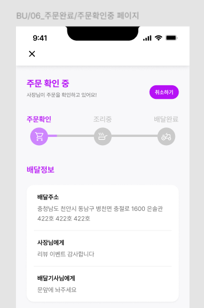
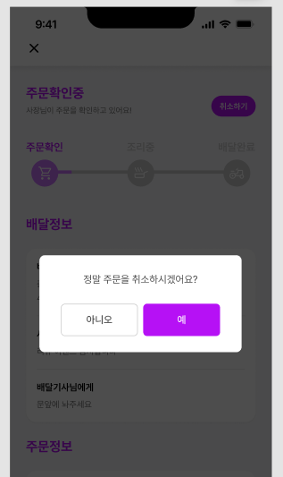
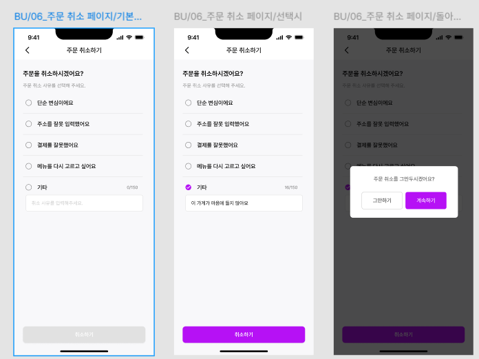

# 8-2 주문 완료 페이지 주문 취소하기(6월 29일 수정)

원문 페이지 ID: 0010221954bc83ea9a5181ed9e1c6d66

> 원문 스냅샷. 명세 확정·앱 배포·수집 완료를 뜻하지 않습니다.

## 원문 속성

```json
{
  "platform": [
    "WEB"
  ],
  "url": "source-page-id:0010221954bc83ea9a5181ed9e1c6d66",
  "상태": "로깅 필요",
  "생성일": "2026-11-12T05:07:43.520Z",
  "이벤트 이름": "8-2 주문 완료 페이지 주문 취소하기(6월 29일 수정)"
}
```

<columns>
<column ratio="50">



</column>
<column ratio="50">

</column>
</columns>





주문 사유를 선택하고 주문 취소 <b>계속하기</b> 버튼 클릭 로깅입니다


event\_params.key

- event\_label : order\_completeCancel
- value :
  - 단순 변심이에요
  - 주소를 잘못 입력했어요
  - 결제를 잘못했어요
  - 메뉴를 다시 고르고 싶어요
  - 기타
    - 해당 문자열 값
- event\_category :
  - click


