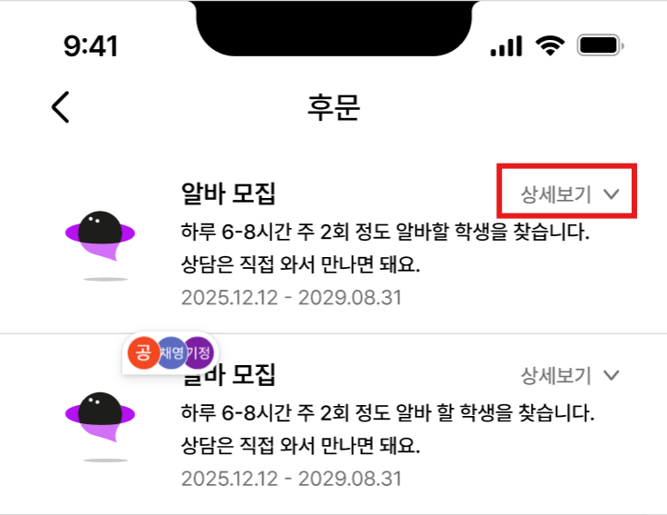

# 5.2 혜택 페이지 상세보기

원문 페이지 ID: 0150221954bc82b0a13c011766185f34

> 원문 스냅샷. 명세 확정·앱 배포·수집 완료를 뜻하지 않습니다.

## 원문 속성

```json
{
  "platform": [
    "ANDROID",
    "IOS",
    "WEB"
  ],
  "url": "source-page-id:0150221954bc82b0a13c011766185f34",
  "상태": "로깅 필요",
  "생성일": "2026-11-08T10:51:54.446Z",
  "이벤트 이름": "5.2 혜택 페이지 상세보기",
  "태그": [
    "5. 새 혜택페이지"
  ]
}
```

<ul>
<li>
<span color="orange">event\_params.key</span>
</li>
<li>
event\_label : shop\_benefit\_detail
</li>
<li>
value : \{상점이름\} 
</li>
<li>
event\_category : 

<ul>
<li>
click 
</li>
</ul>
</li>
<li>
사진
</li>
</ul>


