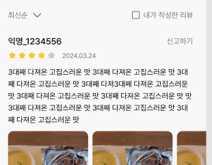
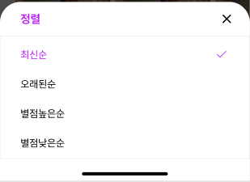

# 4-8 상점상세 리뷰 정렬

원문 페이지 ID: 0170221954bc83dcbd9a81f49c738981

> 원문 스냅샷. 명세 확정·앱 배포·수집 완료를 뜻하지 않습니다.

## 원문 속성

```json
{
  "platform": [
    "ANDROID",
    "IOS",
    "WEB"
  ],
  "url": "source-page-id:0170221954bc83dcbd9a81f49c738981",
  "상태": "완료",
  "생성일": "2026-11-12T05:07:41.573Z",
  "이벤트 이름": "4-8 상점상세 리뷰 정렬",
  "태그": [
    "4. 리뷰 페이지"
  ]
}
```

<columns>
<column ratio="50">

</column>
<column ratio="50">

</column>
</columns>


정렬 탭을 누르고 4가지 정렬 중 한 정렬을 선택했을 때 로깅입니다


<span color="orange">event\_params.key</span>

<ul>
<li>
event\_label : shop\_detail\_view\_review\_can
</li>
<li>
value : 

- 최신순
- 오래된순
- 별점높은순
- 별점낮은순
</li>
<li>
event\_category : click
</li>
</ul>


---


