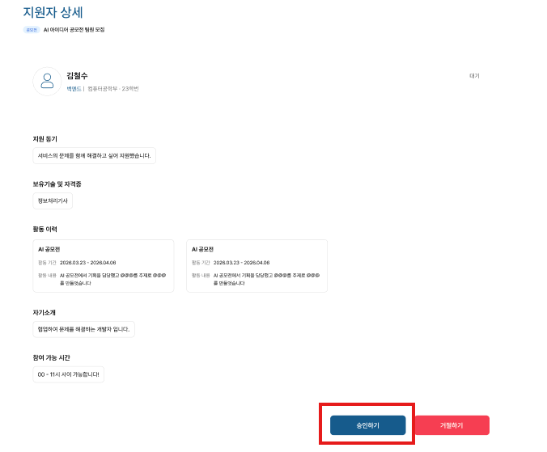
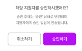
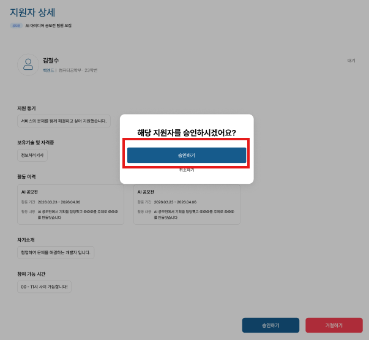
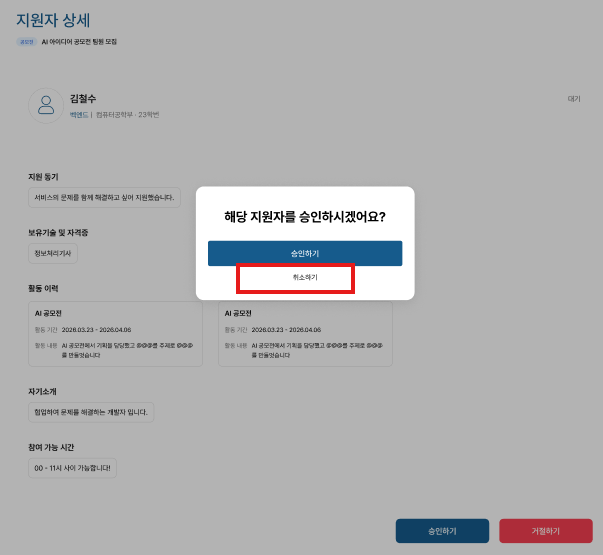
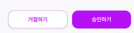
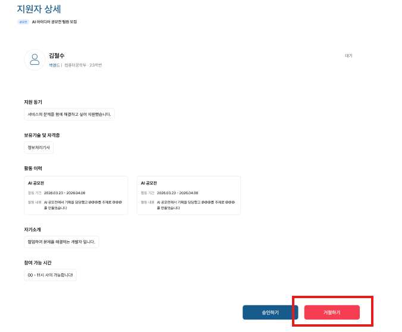
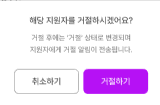
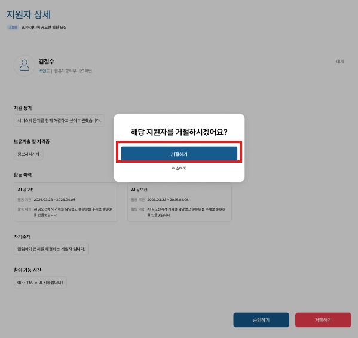
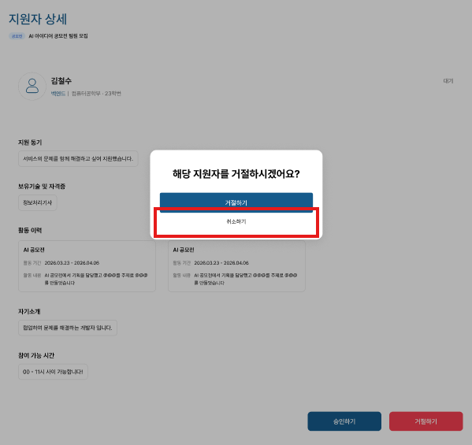
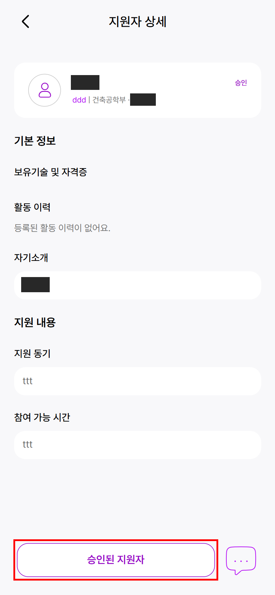

# 11. 지원자 상세

원문 페이지 ID: 0240221954bc831b93fc81ca70121ae3

> 원문 스냅샷. 명세 확정·앱 배포·수집 완료를 뜻하지 않습니다.

## 원문 속성

```json
{
  "platform": [
    "WEB",
    "ANDROID",
    "IOS"
  ],
  "url": "source-page-id:0240221954bc831b93fc81ca70121ae3",
  "구분": "지원자 관리 -> 지원자 상세",
  "상태": "로깅 필요",
  "생성일": "2026-11-12T05:08:14.387Z",
  "이벤트 이름": "11\\. 지원자 상세"
}
```

<details>
<summary>과거 로깅</summary>

① 지원자 승인

- event\_label : team\_recruitment\_created\_post\_applicant\_approve
- value : 승인하기
- event\_category : click




② 지원자 승인 확정

- event\_label : team\_recruitment\_created\_post\_applicant\_approve\_confirm
- value : 승인하기
- event\_category : click





③ 지원자 승인 취소

- event\_label : team\_recruitment\_created\_post\_applicant\_approve\_cancel
- value : 취소하기
- event\_category : click




④ 지원자 거절

- event\_label : team\_recruitment\_created\_post\_applicant\_reject
- value : 거절하기
- event\_category : click





⑤ 지원자 거절 확정

- event\_label : team\_recruitment\_created\_post\_applicant\_reject\_confirm
- value : 거절하기
- event\_category : click





⑥ 지원자 거절 취소

- event\_label : team\_recruitment\_created\_post\_applicant\_reject\_cancel
- value : 취소하기
- event\_category : click



</details>

<details>
<summary>새 로깅</summary>

① 지원자 승인

- 설명: 지원자 상세 화면에서 승인하기 버튼을 클릭해 승인 확인 팝업을 여는 경우
- screen\_view: <code>team_applicant_detail</code>
- event\_name: <code>DA1</code>
- event\_label: <code>team_recruit__team_applicant_detail__team_application_review__approve_open__click</code>
- value: 승인하기
- event\_category: <code>click</code>

② 지원자 승인 확정

- 설명: 승인 확인 팝업에서 승인하기를 클릭해 지원자를 최종 승인하는 경우
- screen\_view: <code>team_applicant_detail</code>
- event\_name: <code>DA1</code>
- event\_label: <code>team_recruit__team_applicant_detail__team_application_review__approve_confirm__click</code>
- value: 승인하기
- event\_category: <code>click</code>

③ 지원자 승인 취소

- 설명: 승인 확인 팝업에서 취소하기를 클릭해 팝업을 닫는 경우
- screen\_view: <code>team_applicant_detail</code>
- event\_name: <code>DA1</code>
- event\_label: <code>team_recruit__team_applicant_detail__team_application_review__approve_cancel__click</code>
- value: 취소하기
- event\_category: <code>click</code>

④ 지원자 거절

- 설명: 지원자 상세 화면에서 거절하기 버튼을 클릭해 거절 확인 팝업을 여는 경우
- screen\_view: <code>team_applicant_detail</code>
- event\_name: <code>DA1</code>
- event\_label: <code>team_recruit__team_applicant_detail__team_application_review__reject_open__click</code>
- value: 거절하기
- event\_category: <code>click</code>

⑤ 지원자 거절 확정

- 설명: 거절 확인 팝업에서 거절하기를 클릭해 지원자를 최종 거절하는 경우
- screen\_view: <code>team_applicant_detail</code>
- event\_name: <code>DA1</code>
- event\_label: <code>team_recruit__team_applicant_detail__team_application_review__reject_confirm__click</code>
- value: 거절하기
- event\_category: <code>click</code>

⑥ 지원자 거절 취소

- 설명: 거절 확인 팝업에서 취소하기를 클릭해 팝업을 닫는 경우
- screen\_view: <code>team_applicant_detail</code>
- event\_name: <code>DA1</code>
- event\_label: <code>team_recruit__team_applicant_detail__team_application_review__reject_cancel__click</code>
- value: 취소하기
- event\_category: <code>click</code>

### 참고사진 (지원자 상세)

① 지원자 승인

<columns>
<column ratio="50">
<b>웹</b>

<b>참고사진 · 웹</b>

웹 — 사진 없음 (추가 필요)
</column>
<column ratio="50">
<b>모바일</b>

<b>참고사진 · 모바일</b>

모바일 — 지원자 상세 승인하기/거절하기 버튼 자리 (출처: stage 실제 캡처, 빨간 네모 = 버튼 위치)


</column>
</columns>

②\~⑥: 웹·모바일 모두 사진 없음 (추가 필요, 사유는 검토사항 참고)

② 지원자 승인 확정

<columns>
<column ratio="50">
<b>웹</b>

<b>참고사진 · 웹</b>

웹 — 사진 없음 (추가 필요)
</column>
<column ratio="50">
<b>모바일</b>

<b>참고사진 · 모바일</b>

모바일 — 사진 없음 (추가 필요)
</column>
</columns>

③ 지원자 승인 취소

<columns>
<column ratio="50">
<b>웹</b>

<b>참고사진 · 웹</b>

웹 — 사진 없음 (추가 필요)
</column>
<column ratio="50">
<b>모바일</b>

<b>참고사진 · 모바일</b>

모바일 — 사진 없음 (추가 필요)
</column>
</columns>

④ 지원자 거절

<columns>
<column ratio="50">
<b>웹</b>

<b>참고사진 · 웹</b>

웹 — 사진 없음 (추가 필요)
</column>
<column ratio="50">
<b>모바일</b>

<b>참고사진 · 모바일</b>

모바일 — 사진 없음 (추가 필요)
</column>
</columns>

⑤ 지원자 거절 확정

<columns>
<column ratio="50">
<b>웹</b>

<b>참고사진 · 웹</b>

웹 — 사진 없음 (추가 필요)
</column>
<column ratio="50">
<b>모바일</b>

<b>참고사진 · 모바일</b>

모바일 — 사진 없음 (추가 필요)
</column>
</columns>

⑥ 지원자 거절 취소

<columns>
<column ratio="50">
<b>웹</b>

<b>참고사진 · 웹</b>

웹 — 사진 없음 (추가 필요)
</column>
<column ratio="50">
<b>모바일</b>

<b>참고사진 · 모바일</b>

모바일 — 사진 없음 (추가 필요)
</column>
</columns>
</details>
