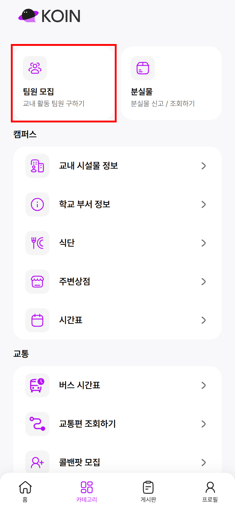

# 14. 카테고리_팀원 모집 진입 (클릭) - 추가된 로깅

원문 페이지 ID: 02f0221954bc83b3bc5e814b70e0cf2c

> 원문 스냅샷. 명세 확정·앱 배포·수집 완료를 뜻하지 않습니다.

## 원문 속성

```json
{
  "platform": [
    "ANDROID",
    "IOS"
  ],
  "url": "source-page-id:02f0221954bc83b3bc5e814b70e0cf2c",
  "구분": "카테고리",
  "상태": "로깅 필요",
  "생성일": "2026-11-08T10:52:09.819Z",
  "이벤트 이름": "14\\. 카테고리\\_팀원 모집 진입 (클릭) - 추가된 로깅"
}
```

<details>
<summary>이전 로깅</summary>

- 없음 (새로 추가한 로깅)
</details>

<details>
<summary>새 로깅 (26.10.17)</summary>

- 설명: 하단 네비게이션바 카테고리 화면에서 팀원 모집을 클릭해 팀원 모집 목록 화면으로 들어가는 경우
- screen\_view: <code>main_category</code>
- event\_name: <code>DA1</code>
- event\_label: <code>team_recruit__main_category__team_recruit_entry__category_entry__click</code>
- value: 팀원 모집
- event\_category: <code>click</code>

<details>
<summary>검토사항</summary>

- 통합 가이드·후속: [로깅 통합 가이드](3c30221954bc8214b1c481c5bbb6fba5.md)
- 웹: 없음 (모바일 웹은 /category 화면에서 동일)
- label DA2 기준 정렬 (2026-10-27): <code>team_recruit__main_category__entry__click</code> → <code>team_recruit__main_category__team_recruit_entry__category_entry__click</code>
</details>

### 참고사진 (카테고리 진입)

<columns>
<column ratio="50">
<b>웹</b>

<details>
<summary>참고사진 · 웹</summary>

웹 — 해당 없음 (모바일 웹은 /category 화면에서 동일)
</details>
</column>
<column ratio="50">
<b>모바일</b>

<details>
<summary>참고사진 · 모바일</summary>

모바일 — 카테고리 팀원 모집 진입 (출처: stage 실제 캡처, 빨간 네모 = 클릭 위치)


</details>
</column>
</columns>
</details>
