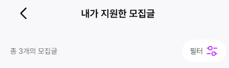
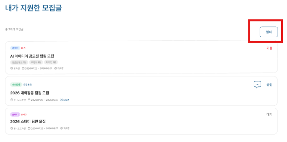
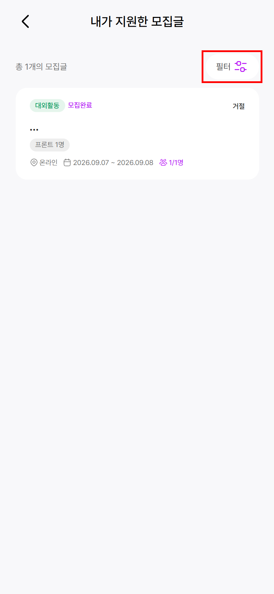

# 8. 필터 클릭

원문 페이지 ID: 03b0221954bc8223943c01a21779d79b

> 원문 스냅샷. 명세 확정·앱 배포·수집 완료를 뜻하지 않습니다.

## 원문 속성

```json
{
  "platform": [
    "WEB",
    "ANDROID",
    "IOS"
  ],
  "url": "source-page-id:03b0221954bc8223943c01a21779d79b",
  "구분": "내가 지원한 모집글",
  "상태": "로깅 필요",
  "생성일": "2026-11-12T05:08:10.506Z",
  "이벤트 이름": "8\\. 필터 클릭"
}
```

<details>
<summary>과거 로깅</summary>

- event\_label : team\_recruitment\_applied\_post\_filter
- value : 필터
- event\_category : click





</details>

<details>
<summary>새 로깅</summary>

- 설명: 내가 지원한 모집글 화면에서 필터 버튼을 클릭해 필터 팝업(지원 상태 / 정렬)을 여는 경우
- screen\_view: <code>team_applied</code>
- event\_name: <code>DA1</code>
- event\_label: <code>team_recruit__team_applied__filter__open__click</code>
- value: 필터
- event\_category: <code>click</code>

### 참고사진 (필터 클릭)

<columns>
<column ratio="50">
<b>웹</b>

<b>참고사진 · 웹</b>

웹 — 사진 없음 (추가 필요)
</column>
<column ratio="50">
<b>모바일</b>

<b>참고사진 · 모바일</b>

모바일 — 내가 지원한 모집글 필터 클릭 (출처: stage 실제 캡처, 빨간 네모 = 클릭 위치)


</column>
</columns>
</details>
