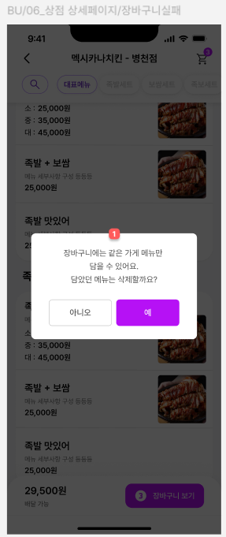

# 3-13 다른 가게 메뉴로 인한 카트 추가 실패

원문 페이지 ID: 06a0221954bc83999fa9817c1331e9c2

> 원문 스냅샷. 명세 확정·앱 배포·수집 완료를 뜻하지 않습니다.

## 원문 속성

```json
{
  "platform": [
    "ANDROID",
    "IOS"
  ],
  "url": "source-page-id:06a0221954bc83999fa9817c1331e9c2",
  "상태": "로깅 필요",
  "생성일": "2026-11-08T10:51:29.512Z",
  "이벤트 이름": "3-13 다른 가게 메뉴로 인한 카트 추가 실패",
  "태그": [
    "3. 상점 상세 페이지"
  ]
}
```



<span color="orange">event\_params.key</span>

<ul>
<li>
event\_label : shop\_detail\_view\_cart\_menu\_remove
</li>
<li>
value : 

- O
- X
</li>
<li>
event\_category : 

<ul>
<li>
click 
</li>
</ul>
</li>
</ul>
