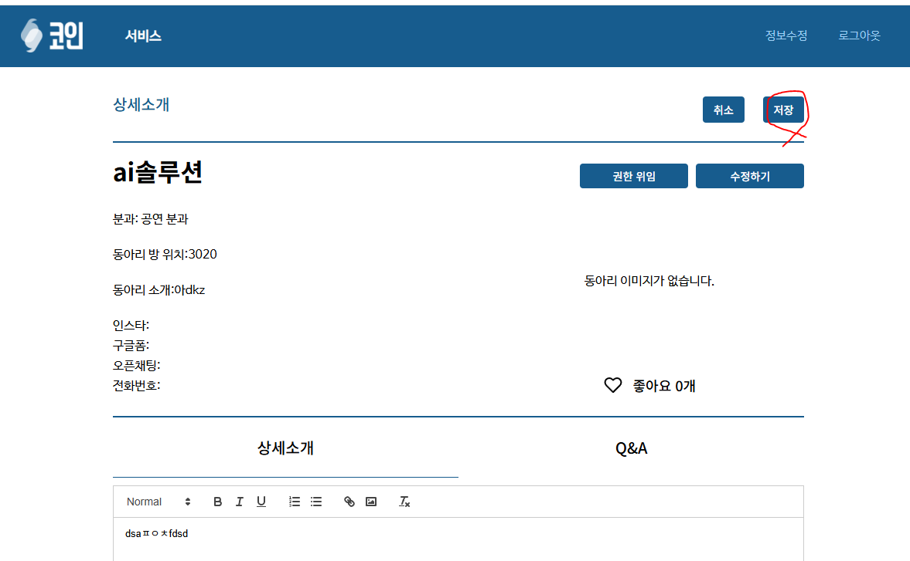
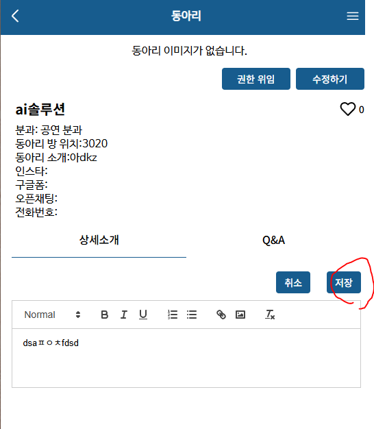

# 5-8.동아리_상세소개 수정하기_저장 클릭

원문 페이지 ID: 0700221954bc83ec9d22016446ce8f87

> 사용자 제공 ZIP 내보내기 보관본. 레거시·동결·검토 상태는 원문을 따르며 코드 생성 승인·앱 배포 완료를 뜻하지 않습니다.

platform: WEB
상태: 완료

- 설명: 동아리 소개 화면 → 상세소개 수정하기를 누른후 → 저장 버튼 클릭
- event_name : “CAMPUS”
- event_label : “club_introduction_correction_save”
- value : “저장”
- event_category : “click”

- 웹 참고사진

- 모바일 웹 뷰

