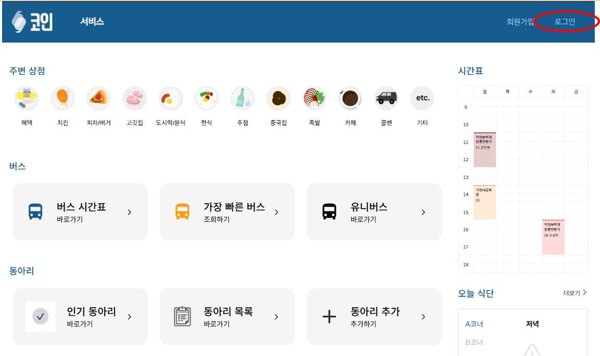
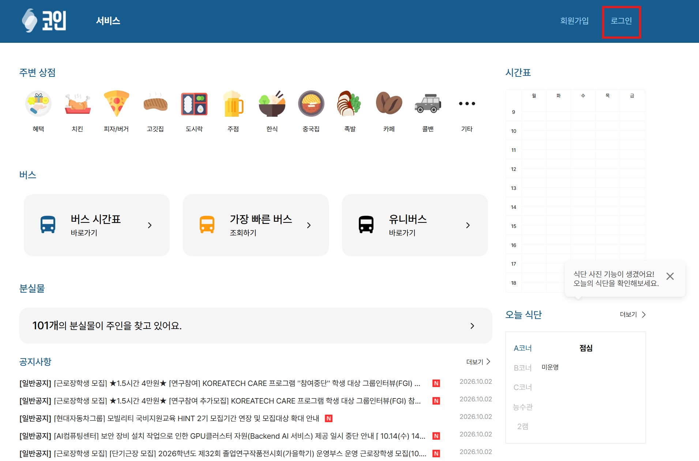
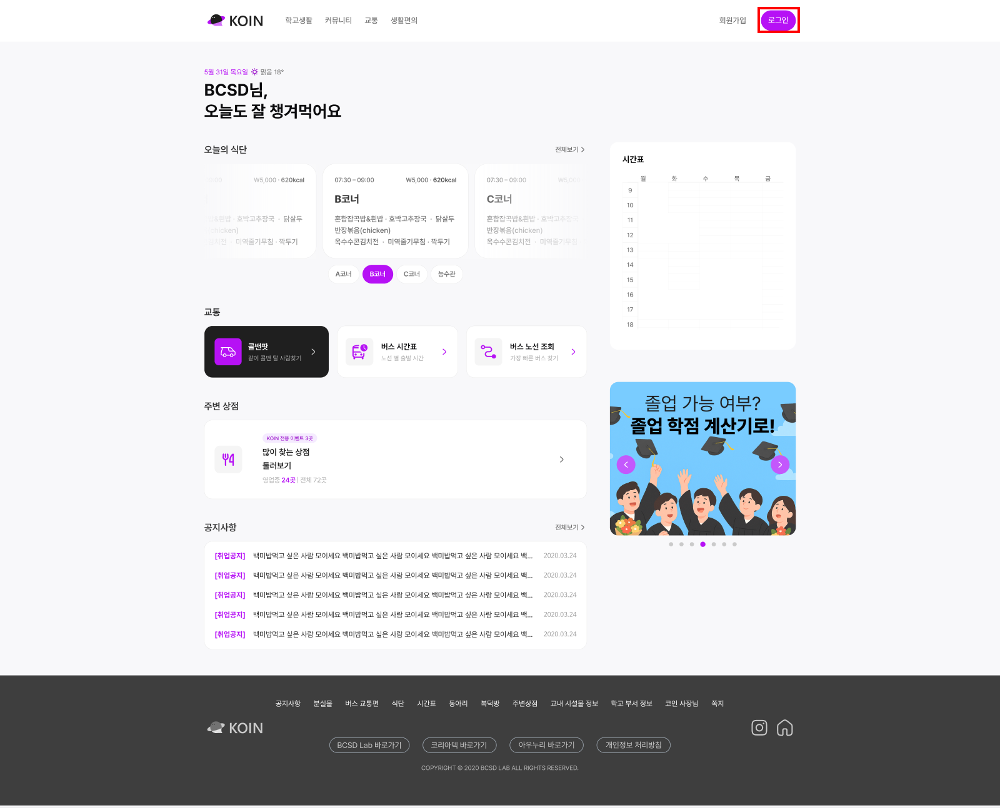

# 2-1 헤더_로그인 진입(클릭)

원문 페이지 ID: 0720221954bc82e1a235819b683cf85e

> 원문 스냅샷. 명세 확정·앱 배포·수집 완료를 뜻하지 않습니다.

## 원문 속성

```json
{
  "platform": [
    "WEB"
  ],
  "url": "source-page-id:0720221954bc82e1a235819b683cf85e",
  "구분": "로그인",
  "상태": "로깅 필요",
  "생성일": "2026-11-12T05:07:33.796Z",
  "이벤트 이름": "2-1 헤더\\_로그인 진입(클릭)",
  "태그": [
    "로그인"
  ]
}
```

<details>
<summary>과거 로깅</summary>

- event\_label : “header”
- value : “로그인 시도<b>”</b>
- event\_category : “click”



<b>이전 WEB 참고사진 · 리디자인 전</b>

<b>참고사진 · 웹</b>

<b>웹</b>


</details>

<details>
<summary>새 로깅</summary>

- 설명: WEB 공통 헤더의 로그인 버튼을 클릭해 로그인 화면으로 이동할 때 기록한다. 로그인 성공 이벤트와 구분한다.
- event\_name: <code>DA2</code>
- screen\_view: <code>header</code>
- event\_label: <code>account__header__login__header_entry__click</code>
- value: 로그인 시도
- event\_category: <code>click</code>

### 참고사진 (로그인 버튼 클릭)

<b>웹</b>

<b>참고사진 · 웹</b>

WEB 리디자인 · [Figma 시안](https://www.figma.com/design/DPlcYuiFxhyT5ULbqec59i/KOIN-Web?node-id=11541-33352) · 2026-11-04. 빨간 네모 = 로그인 버튼 클릭 위치. 원본 캡처에 코드로 테두리만 표시했으며 실제 서비스 캡처·SDK 검증을 뜻하지 않는다.

<b>전체 홈 화면</b>



<b>모바일</b>

<b>참고사진 · 모바일</b>

해당 없음 — 이 페이지는 WEB 헤더 전용 명세다. 앱 프로필 버튼은 기존 모바일 명세를 따른다.
</details>
