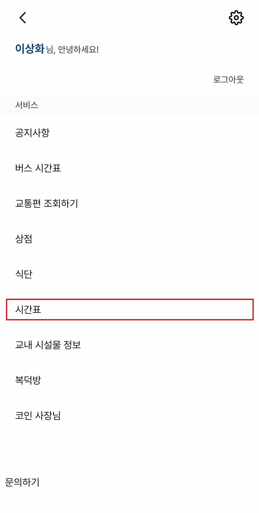
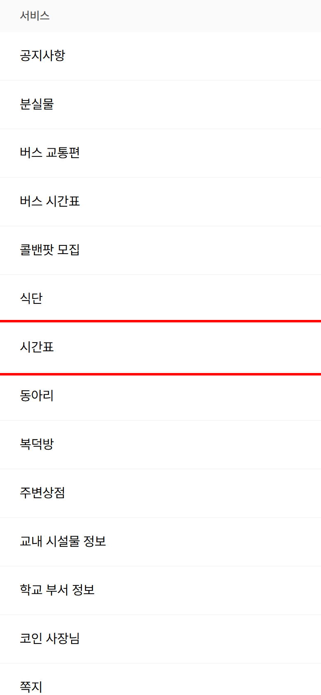

# [레거시·이관 원문] 2-5. (앱, 반응형 웹) 햄버거_시간표

원문 페이지 ID: 0720221954bc834d94e081b33664b7bd

> 원문 스냅샷. 명세 확정·앱 배포·수집 완료를 뜻하지 않습니다.

## 원문 속성

```json
{
  "platform": [
    "ANDROID",
    "IOS"
  ],
  "url": "source-page-id:0720221954bc834d94e081b33664b7bd",
  "상태": "완료",
  "생성일": "2026-11-12T05:08:09.161Z",
  "이벤트 이름": "\\[레거시·이관 원문\\] 2-5. (앱, 반응형 웹) 햄버거\\_시간표",
  "태그": [
    "시간표"
  ]
}
```

<details>
<summary>과거 로깅</summary>

- event\_label : “hamburger”
- value : “시간표”
- event\_category : “click”
- 참고 이미지



- 설명: 모바일 상단 메뉴(☰, 햄버거)를 열고 서비스 목록에서 시간표를 클릭해 시간표 화면으로 들어가는 경우
- screen\_view: <code>main_category</code>
- event\_name: <code>DA1</code>
- event\_label: <code>timetable__main_category__timetable_entry__category_entry__click</code>
- value: 시간표
- event\_category: <code>click</code>

### 참고사진 (기능 표시)

<columns>
<column ratio="50">
<b>웹</b>

<b>참고사진 · 웹</b>

해당 없음 (모바일 전용)
</column>
<column ratio="50">
<b>모바일</b>

<b>참고사진 · 모바일</b>

모바일 — 햄버거 메뉴의 시간표 (출처: stage 실제 캡처, 빨간 네모 = 클릭 위치)


</column>
</columns>
</details>

<details>
<summary>새 로깅</summary>

레거시. [3-6 카테고리 내부 클릭 (현재 로깅) 2026.08.30 이후 찍히는 로깅](5540221954bc83d0aed681206affda1b.md)를 따른다.
</details>
