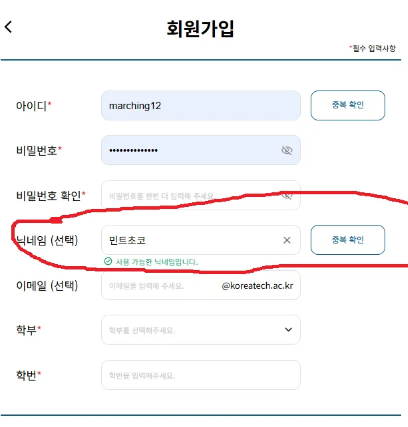
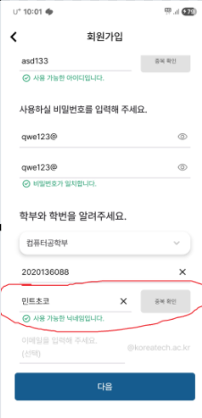
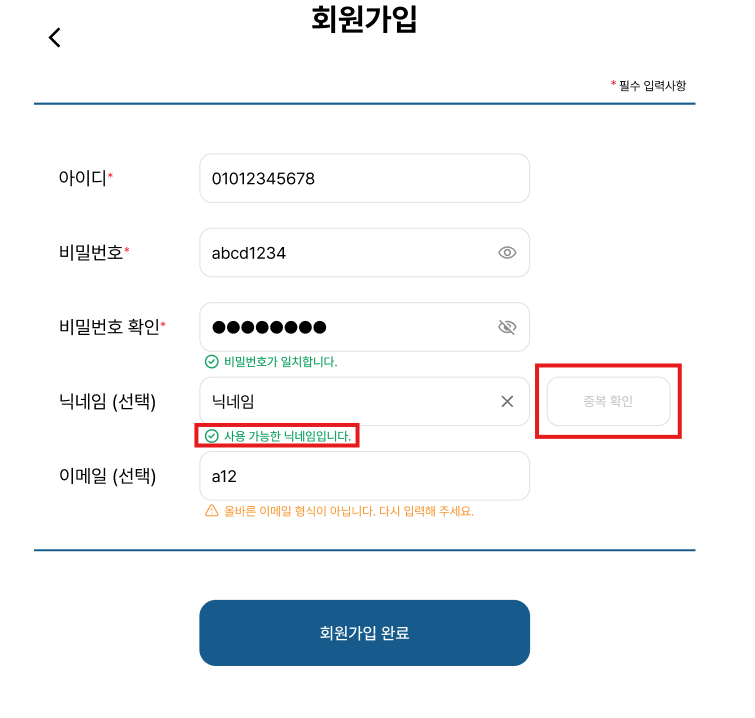
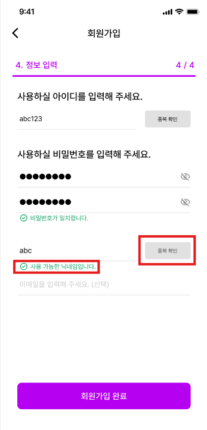

# 1-8 학생_외부인_닉네임_중복확인

원문 페이지 ID: 0930221954bc8256a06381235bb8e148

> 원문 스냅샷. 명세 확정·앱 배포·수집 완료를 뜻하지 않습니다.

## 원문 속성

```json
{
  "platform": [
    "ANDROID",
    "IOS",
    "WEB"
  ],
  "url": "source-page-id:0930221954bc8256a06381235bb8e148",
  "구분": "정보입력",
  "상태": "로깅 필요",
  "생성일": "2026-11-12T05:07:33.618Z",
  "이벤트 이름": "1-8 학생\\_외부인\\_닉네임\\_중복확인",
  "태그": [
    "회원가입"
  ]
}
```

<details>
<summary>과거 로깅</summary>

- event\_label : “create\_account”
- value : “닉네임생성<b>”</b>
- event\_category : “click”
- custom\_session\_id : \{sign\_up\}\_\{0\}\_\{플랫폼\}\_\{세션시작시간\}\_\{랜덤값\}

모든 중복 확인 클릭이 아닌 사용 가능한 닉네임을 찾은 순간에만 로깅 해주시면 됩니다.


웹




모바일


</details>

<details>
<summary>새 로깅</summary>

- 설명: 회원가입 정보입력에서 사용 가능한 닉네임을 찾은 순간에만 기록한다. 모든 중복확인 버튼 클릭을 기록하는 조건으로 확대하지 않는다.
- event\_name: <code>DA2</code>
- screen\_view: <code>input_user_info</code>
- event\_label: <code>account__input_user_info__sign_up__nickname_available__click</code>
- value: 닉네임생성
- event\_category: <code>click</code>
- custom\_session\_id : \{sign\_up\}\_\{0\}\_\{플랫폼\}\_\{세션시작시간\}\_\{랜덤값\}

모든 중복 확인 클릭이 아닌 사용 가능한 닉네임을 찾은 순간에만 로깅 해주시면 됩니다.

<b>참고사진 · 웹</b>

<b>웹</b>



<b>참고사진 · 모바일</b>

<b>모바일</b>


</details>
