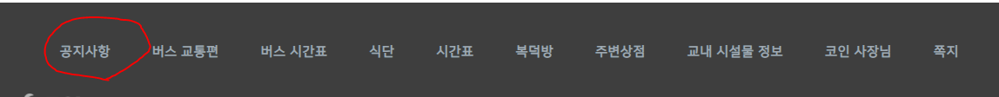
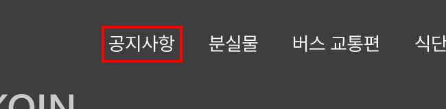
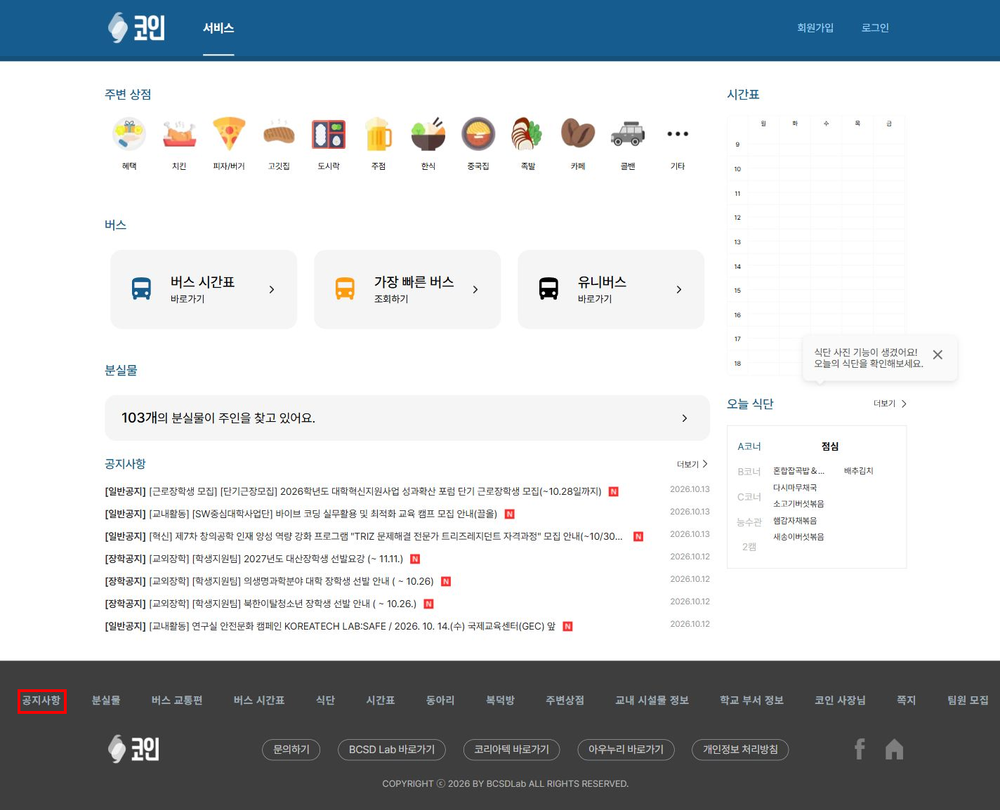

# 2-2. 푸터_공지사항_클릭

원문 페이지 ID: 0a90221954bc82898d4d8125f9edc616

> 원문 스냅샷. 명세 확정·앱 배포·수집 완료를 뜻하지 않습니다.

## 원문 속성

```json
{
  "platform": [
    "WEB"
  ],
  "url": "source-page-id:0a90221954bc82898d4d8125f9edc616",
  "상태": "로깅 필요",
  "이름": "2-2. 푸터\\_공지사항\\_클릭",
  "태그": [
    "2. 헤더/푸터/햄버거_공지사항"
  ]
}
```

<details>
<summary>이전 로깅</summary>

- 설명: 푸터 에서 공지사항 클릭
- event\_label : “footer”
- value : “공지사항”
- event\_category : “click”
- 참고사진



</details>

<details>
<summary>새 로깅 (26.10.05)</summary>

- 설명: 웹 푸터의 공지사항 메뉴 클릭.
- screen\_view: <code>footer</code>
- event\_name: <code>DA2</code>
- event\_label: <code>board__footer__notice_entry__footer_entry__click</code>
- value: 공지사항
- event\_category: <code>click</code>

<details>
<summary>검토사항</summary>

- screen\_view 확정 (2026-10-30 상민 직접 지시): event\_label의 두 번째 구간과 같은 <code>footer</code> 고정값을 사용한다. 이전 동적 화면명 표기안은 이 결정으로 대체한다. 라벨·category·value·발생 시점·플랫폼·사진은 유지하며 SDK 적용·실제 전송·한 번 전송은 미확인이다.
- label 통일 (2026-10-27): <code>board__footer__notice_entry__footer_entry</code> → <code>board__footer__notice_entry__footer_entry__click</code>
</details>

### 참고사진 (WEB 리디자인 · 푸터 공지사항)

<b>웹</b>

<details>
<summary>참고사진 · 웹</summary>

[Figma 원본](https://www.figma.com/design/DPlcYuiFxhyT5ULbqec59i/KOIN-Web?node-id=17664-28870) · 2026-11-04. 원본 캡처에 빨간 네모만 추가했다. 빨간 네모는 기존 명세의 공지사항 클릭 위치다. 실제 SDK 적용·배포·전송은 미확인이다.


<b>클릭 위치 확대</b>


</details>

<b>기존 참고사진 (과거 디자인·원문 보존)</b>

<details>
<summary>참고사진 · 웹</summary>

<b>웹</b>

실제 데스크톱 웹 캡처(2026-10-13)에 해당 푸터 메뉴의 빨간 테두리만 표시했다.


</details>
</details>
