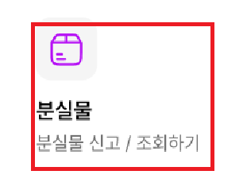

# 3-2 분실물 클릭 (과거 로깅) 2026.08.30 이후 로깅 중단

원문 페이지 ID: 0af0221954bc82e9a33f01c161afef8c

> 원문 스냅샷. 명세 확정·앱 배포·수집 완료를 뜻하지 않습니다.

## 원문 속성

```json
{
  "platform": [
    "ANDROID",
    "IOS",
    "WEB"
  ],
  "url": "source-page-id:0af0221954bc82e9a33f01c161afef8c",
  "구분": "카테고리",
  "상태": "완료",
  "생성일": "2026-11-08T10:52:04.268Z",
  "이벤트 이름": "3-2 분실물 클릭 (과거 로깅) 2026.08.30 이후 로깅 중단"
}
```

- event\_label : category\_lost\_property
- value : 분실물
- event\_category : click



