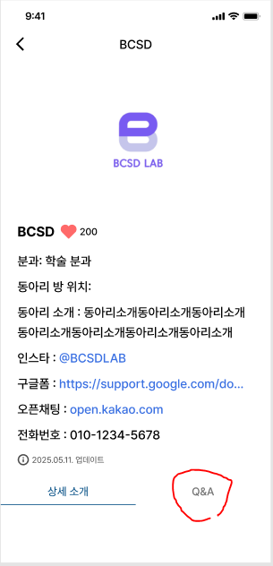
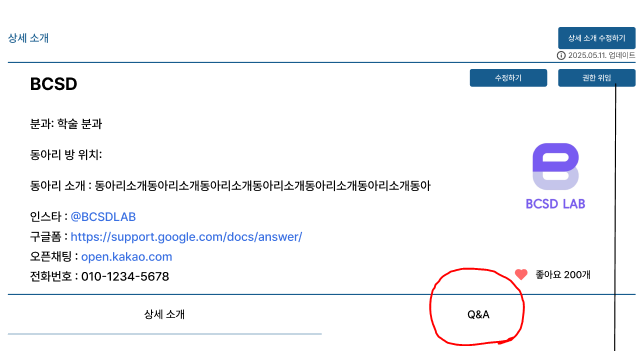

# 5-6.동아리_탭 클릭(추가사항)

원문 페이지 ID: 0b30221954bc83f6a13a815ca51cba3b

> 사용자 제공 ZIP 내보내기 보관본. 레거시·동결·검토 상태는 원문을 따르며 코드 생성 승인·앱 배포 완료를 뜻하지 않습니다.

platform: ANDROID, IOS, WEB
상태: 로깅 필요

- 설명: 동아리 소개 화면에서 상세소개나 Q&A탭 클릭

클릭한 탭에 따라 value는 Q&A나 상세 소개로 부탁드립니다.

- event_name : “CAMPUS”
- event_label : “club_tab_select”
- value : {”상세 소개”, “Q&A”, “모집”, “행사”}
- event_category : “click”
- 참고사진

- 웹 참고사진

