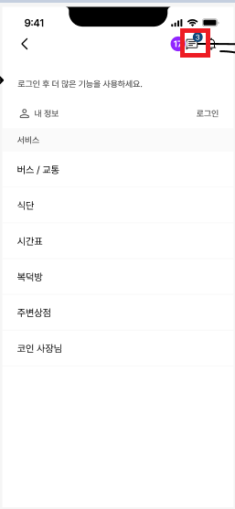
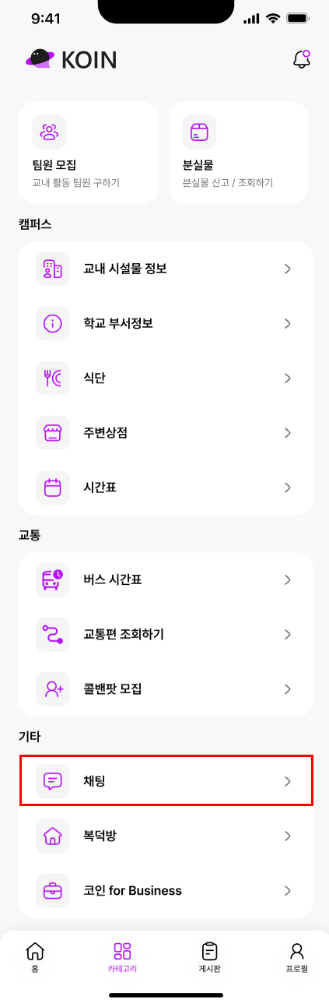

# [레거시] 11-15.카테고리_채팅(쪽지)_클릭

원문 페이지 ID: 0dc0221954bc8316be7a815e4460791f

> 원문 스냅샷. 명세 확정·앱 배포·수집 완료를 뜻하지 않습니다.

## 원문 속성

```json
{
  "platform": [
    "ANDROID",
    "IOS"
  ],
  "url": "source-page-id:0dc0221954bc8316be7a815e4460791f",
  "상태": "레거시",
  "이름": "\\[레거시\\] 11-15.카테고리\\_채팅(쪽지)\\_클릭",
  "태그": [
    "11.분실물"
  ]
}
```

<details>
<summary>과거 로깅</summary>

<ul>
<li>
설명 : 햄버거 버튼을 누른 화면에서 쪽지 버튼 클릭
</li>
<li>
event\_label : “hamburger”
</li>
<li>
value : “쪽지<b>”</b>
</li>
<li>
event\_category : “click” 
</li>
<li>
참고사진
</li>
</ul>




- 설명: 메인 카테고리 화면에서 ‘채팅’를 클릭한다.
- screen\_view: <code>main_category</code>
- event\_label: <code>chat__main_category__chat_entry__category_entry__click</code>
- event\_name: <code>DA2</code>
- event\_category: <code>click</code>
- value: 쪽지

### 참고사진 (기능 표시)

<b>참고사진 · 모바일</b>

화면 정의에 제공된 카테고리 캡처. 해당 메뉴의 위치에 빨간 테두리만 추가. 이번 작업의 실제 Android 신규 캡처가 아님.


</details>

<details>
<summary>새 로깅</summary>

레거시. [3-6 카테고리 내부 클릭 (현재 로깅) 2026.08.30 이후 찍히는 로깅](5540221954bc83d0aed681206affda1b.md)를 따른다.
</details>
