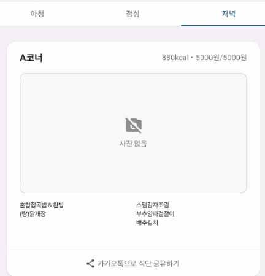

# 3-6. 식단_저녁_스크롤

원문 페이지 ID: 0dd0221954bc8381bf850126bf46c6e4

> 누락 원본 복구 스냅샷. 원본의 과거값·검토 기록을 보존하며 생성 계약으로 자동 승인하지 않습니다.

대조 기록: [87개 원본 복구 및 8개 차이 정리](../recovery-review.md)

관련 기존 보관본: [3-6. 식단_저녁_스크롤](a230221954bc8369b994016a3caafcaf.md)

## 원문 속성

```json
{
  "platform": [
    "ANDROID",
    "IOS",
    "WEB"
  ],
  "url": "source-page-id:0dd0221954bc8381bf850126bf46c6e4",
  "상태": "완료",
  "생성일": "2026-11-08T10:51:37.495Z",
  "이름": "3-6. 식단\\_저녁\\_스크롤",
  "태그": [
    "3. 식단 상세페이지"
  ]
}
```

<details>
<summary>이전 로깅</summary>


- 설명 : 식단 페이지에서 저녁 식사 부분에서 스크롤
- event\_label : “menu\_time”
- value : “저녁<b>”</b>
- event\_category : “scroll”
- 참고사진





</details>


<details>
<summary>새 로깅 (26.10.17)</summary>


- 레거시: 3-4로 통합. 새 로깅을 만들지 않는다.
- 대체 로깅 : 3-4 (cafeteria\_\_cafeteria\_\_meal\_time\_\_scroll)

<details>
<summary>검토사항</summary>


- 통합 가이드·후속: [로깅 통합 가이드](3c30221954bc8214b1c481c5bbb6fba5.md)

</details>


### 참고사진 (레거시)


<b>웹</b>

<details>
<summary>참고사진 · 웹</summary>


해당 없음 (레거시)

</details>


<b>모바일</b>

<details>
<summary>참고사진 · 모바일</summary>


해당 없음 (레거시)

</details>


</details>
