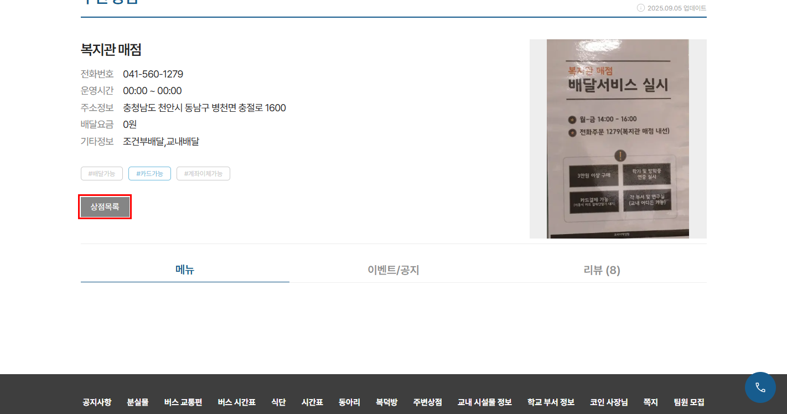
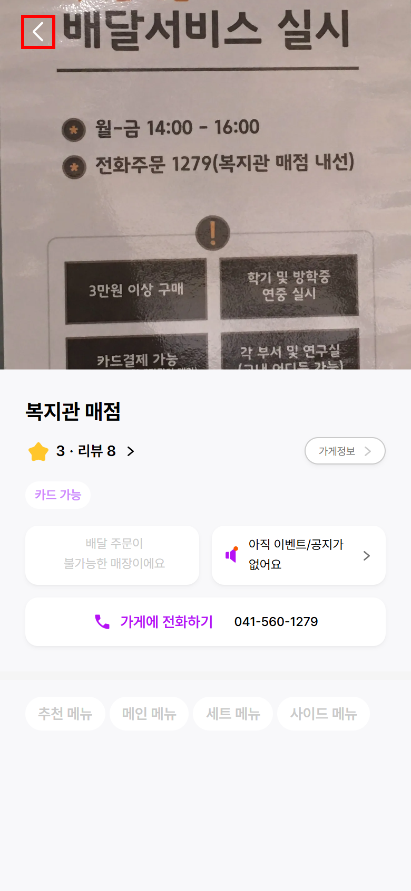

# 3-5-2 상점상세 뒤로 가기 (Click)

원문 페이지 ID: 0e00221954bc8252b9020148f1ed3238

> 원문 스냅샷. 명세 확정·앱 배포·수집 완료를 뜻하지 않습니다.

## 원문 속성

```json
{
  "platform": [
    "ANDROID",
    "IOS"
  ],
  "url": "source-page-id:0e00221954bc8252b9020148f1ed3238",
  "상태": "완료",
  "생성일": "2026-11-12T05:07:36.712Z",
  "이벤트 이름": "3-5-2 상점상세 뒤로 가기 (Click)",
  "태그": [
    "3. 상점 상세 페이지"
  ]
}
```

<details>
<summary>과거 로깅</summary>

<span color="orange">event\_params.key</span>

<ul>
<li>
event\_label : shop\_detail\_view\_back
</li>
<li>
value : \{상점이름\} 
</li>
<li>
event\_category : 

<ul>
<li>
click 
</li>
</ul>
</li>
</ul>


- current\_page : \{돌아간 카테고리\}
- duration\_time : 상점 상세보기에서 카테고리로 돌아간 시간.


---


<p>
카테고리 의미 
</p>

- 뒤로가기 버튼을 눌러 상점 카테고리 페이지로 돌아가는 것.


<p>
시간 관련 주의 사항: 
</p>

<ol>
<li>
상점 상세보기 페이지에서 어떠한 행위를 해도 상관이 없음. <br />즉 상점 상세보기를 들어온 시간부터 상점 상세보기를 떠난 시간까지 측정 
</li>
</ol>


---

<h3>
오류사항 
</h3>

<span color="yellow_bg">햄버거로 나가는걸 측정하지 못하고 있음. </span>

<p>
웹: 
</p>

<p>
상점 목록으로 나가면 swipe 이벤트가 찍히고 있음. 
</p>


<p>
안드: 
</p>

<p>
swipe → click 
</p>


---


[해결 (2)](28e0221954bc83dbbe0181d287e7bec5.md)
</details>

<details>
<summary>새 로깅</summary>

- 설명: 상점 상세 화면에서 나가는 경우
- screen\_view: <code>shop_detail</code>
- event\_name: <code>DA1</code>
- event\_label: <code>shop__shop_detail__navigation__back__click</code>
- value: 뒤로가기
- event\_category: <code>click</code>

### 참고사진 (상점 상세 뒤로가기)

<columns>
<column ratio="50">
<b>웹</b>

<b>참고사진 · 웹</b>

웹 — 상점목록 버튼 클릭 (출처: stage 실제 캡처, 빨간 네모 = 클릭 위치)


</column>
<column ratio="50">
<b>모바일</b>

<b>참고사진 · 모바일</b>

모바일 — 뒤로가기 클릭 (출처: stage 실제 캡처, 빨간 네모 = 클릭 위치)


</column>
</columns>
</details>


