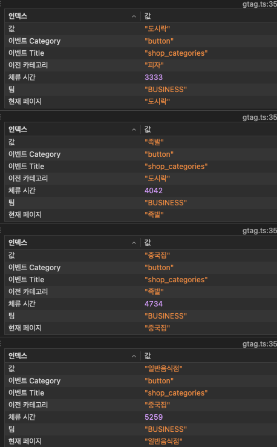
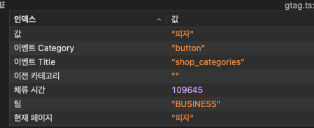

# 해결 (1)

원문 페이지 ID: 1060221954bc8278b7ca81824968cf3c

> 원문 스냅샷. 명세 확정·앱 배포·수집 완료를 뜻하지 않습니다.

## 원문 속성

```json
{
  "title": "해결 (1)"
}
```


---

<p>
IOS 
</p>

1. 이전 카테고리가 나오지 않는 이슈 <br />


→ 전 카테고리가 나오도록 찍히게 해주세요.

And

<ol>
<li>
이전 페이지가 겹치는 이슈 발생. 
</li>
</ol>

<p>
웹 : 
</p>

<ol>
<li>
시간이 중복으로 쌓이는 오류 
</li>
</ol>



<p>
→ 도시락에서 족발로 이동하면 
</p>

<p>
도시락에서 쌓여있던 시간은 리셋하고 족발에서 다시 카운트 해주시면 감사하겠습니다. 
</p>


<ol start="2">
<li>
헤더나 푸터를 통해 들어왔을때 이전 카테고리에 공백이 들어오게 됨. 
</li>
</ol>



<p>
→ 전체보기로 설정해주시면 감사하겠습니다! 
</p>


<p>
상점카테고리에서 상점 카테고리로의 시간을 파악하고자 합니다. 
</p>


<p>
주의사항 : 
</p>

<ol>
<li>
scroll 이벤트에는  아래 3개의 키값은 안보내야함. 
</li>
<li>
웹에서 배달가능, 카드 가능을 누르게 될경우 페이지가 다르게 잡히는데 이 경우 이벤트가 보내져서는 안됨.  
</li>
</ol>


---

<p>
안드 
</p>

<p>
3개 파라미터 추가 안됨. 
</p>


