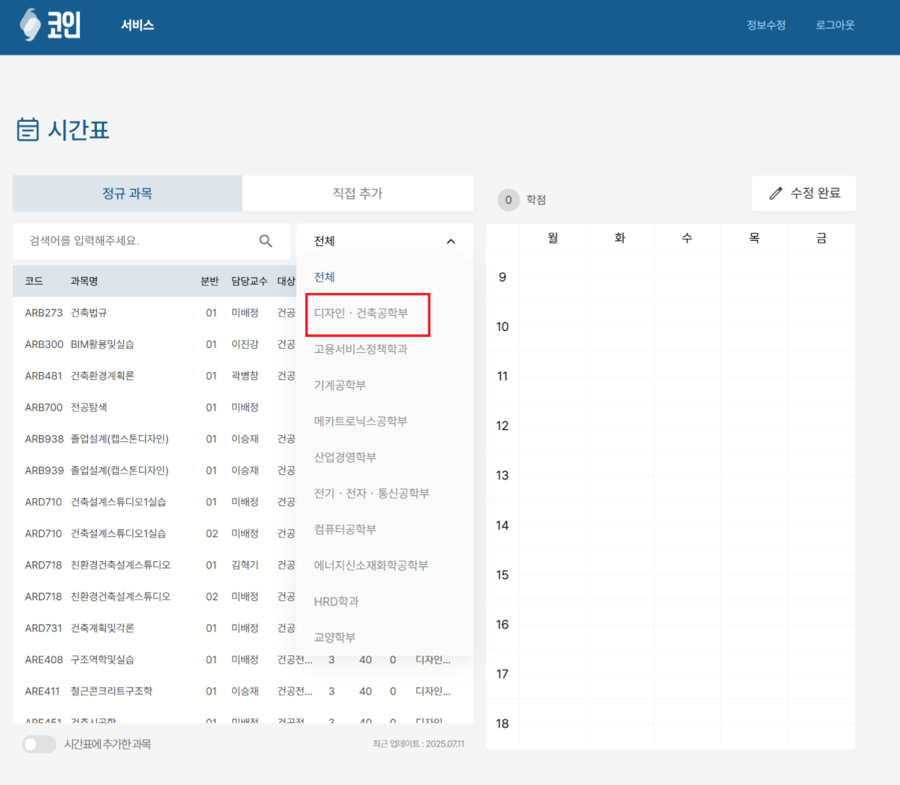
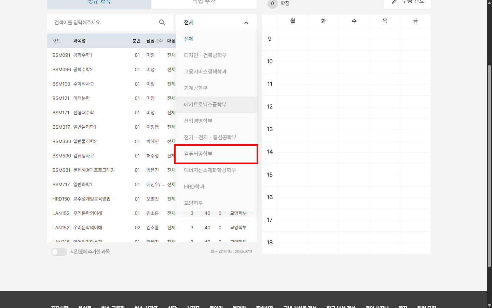

# 2-20. (웹) 시간표_수정_해당 학부 (클릭)

원문 페이지 ID: 10e0221954bc8296ade3015ad6cc451b

> 원문 스냅샷. 명세 확정·앱 배포·수집 완료를 뜻하지 않습니다.

## 원문 속성

```json
{
  "platform": [
    "WEB"
  ],
  "url": "source-page-id:10e0221954bc8296ade3015ad6cc451b",
  "상태": "로깅 필요",
  "생성일": "2026-11-12T05:08:07.886Z",
  "이벤트 이름": "2-20. (웹) 시간표\\_수정\\_해당 학부 (클릭)",
  "태그": [
    "시간표"
  ]
}
```

<details>
<summary>과거 로깅</summary>

- event\_label : “timetable”
- value : “filter\_select\_\{사용자가 클릭한 학부\}”
- event\_category : “click”
- 참고 이미지


</details>

<details>
<summary>새 로깅</summary>

- 설명: 웹 시간표 수정 화면(정규 과목 탭)의 학부 드롭다운(기본 '전체')에서 학부를 골라 과목 목록을 거르는 경우
- screen\_view: <code>timetable_edit</code>
- event\_name: <code>DA1</code>
- event\_label: <code>timetable__timetable_edit__search__department__select</code>
- value: \{학부\} (예: 디자인ㆍ건축공학부) · 학부명은 드롭다운 표기 그대로(가운뎅점 ㆍ 포함), 전체를 고르면 전체
- event\_category: <code>select</code>

### 참고사진 (기능 표시)

<columns>
<column ratio="50">
<b>웹</b>

<b>참고사진 · 웹</b>

웹 — 학부 선택 (출처: stage 실제 캡처, 로그인 상태, 빨간 네모 = 클릭 위치 / 학부 드롭다운을 연 상태)


</column>
<column ratio="50">
<b>모바일</b>

<b>참고사진 · 모바일</b>

해당 없음 (웹 전용)
</column>
</columns>
</details>
