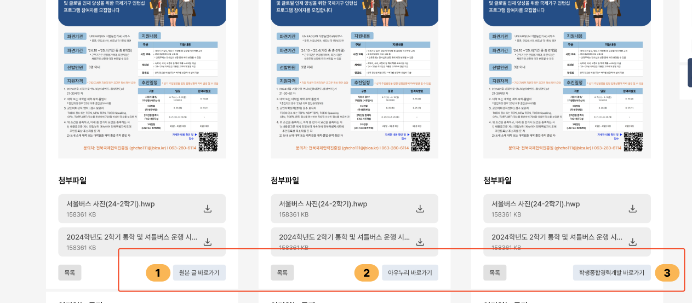

# 5-3. 공지 원본 바로가기_클릭

원문 페이지 ID: 1180221954bc831d989d81ea8679983d

> 사용자 제공 ZIP 내보내기 보관본. 레거시·동결·검토 상태는 원문을 따르며 코드 생성 승인·앱 배포 완료를 뜻하지 않습니다.

platform: ANDROID, IOS
상태: 완료

- 설명 : 공지 상세페이지의 ‘바로가기’ 버튼들 로깅
- event_label : “notice_original_shortcut”
- value : “**원본 글 바로가기”, “아우누리 바로가기”, “학생종합경력개발 바로가기”**
- event_category : “click”
- 참고사항
    - 원본 글 바로가기 - <u>아래 탭들 + ‘코인’</u> 공지사항 제외 나머지 공지사항들
    - 아우누리 바로가기 - ‘현장실습’, ‘학생생활’ 탭 공지사항들
    - 학생종합경력개발 바로가기 - ‘취업’ 탭 공지사항들
- 참고사진
    
    
