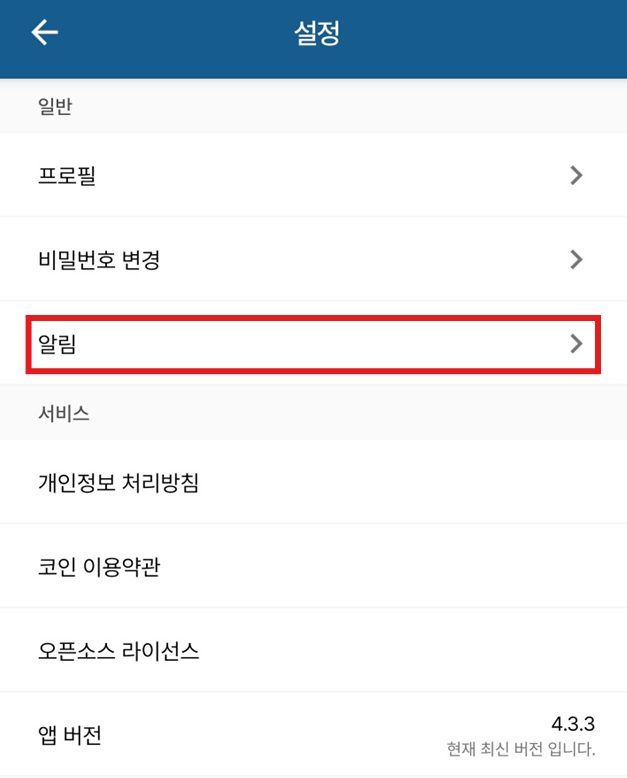
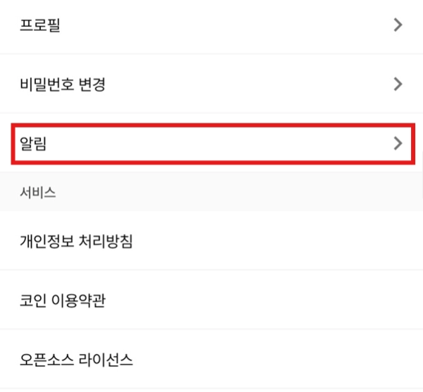

# 5-1. (Android / iOS) 알림설정_클릭

원문 페이지 ID: 1190221954bc83939928017b5b644090

> 원문 스냅샷. 명세 확정·앱 배포·수집 완료를 뜻하지 않습니다.

## 원문 속성

```json
{
  "platform": [
    "ANDROID",
    "IOS"
  ],
  "url": "source-page-id:1190221954bc83939928017b5b644090",
  "상태": "완료",
  "생성일": "2026-11-12T05:07:49.958Z",
  "이름": "5-1. (Android / iOS) 알림설정\\_클릭",
  "태그": [
    "5. 알림설정 페이지 (Android / iOS)"
  ]
}
```

<details>
<summary>과거 로깅</summary>

- 설명 : 설정에서 알림 클릭
- event\_label : “notification”
- value : “알림설정<b>”</b>
- event\_category : “click”
- 참고사진


</details>

<details>
<summary>새 로깅</summary>

- 설명: 프로필 → 설정 화면에서 알림을 클릭해 알림 설정 화면으로 들어가는 경우
- screen\_view: <code>account_config</code>
- event\_name: <code>DA1</code>
- event\_label: <code>cafeteria__account_config__notification_config__entry__click</code>
- value: 알림설정
- event\_category: <code>click</code>

### 참고사진 (알림설정 클릭)

<columns>
<column ratio="50">
<b>웹</b>

<b>참고사진 · 웹</b>

해당 없음 (앱 전용)
</column>
<column ratio="50">
<b>모바일</b>

<b>참고사진 · 모바일</b>


</column>
</columns>
</details>
