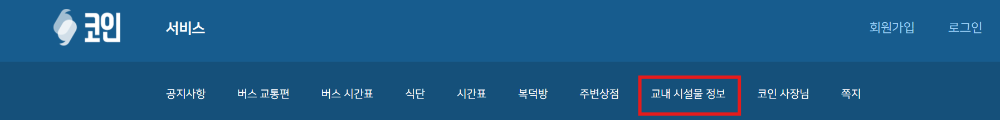
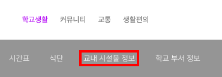
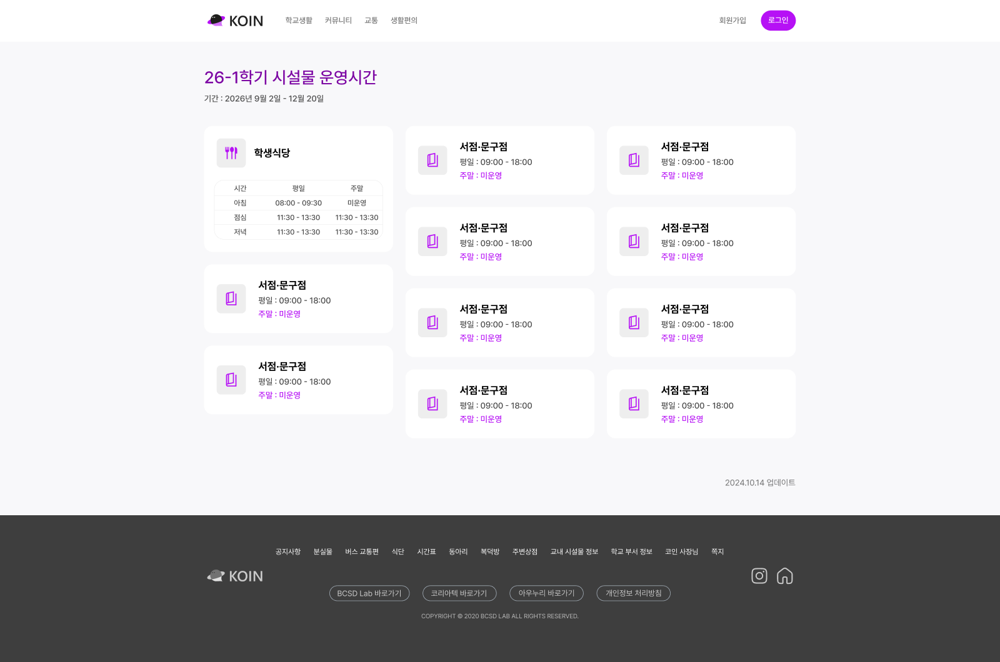

# 10-1. 헤더_교내 시설물 정보_클릭

원문 페이지 ID: 1290221954bc8311bea00172cdc03d3a

> 원문 스냅샷. 명세 확정·앱 배포·수집 완료를 뜻하지 않습니다.

## 원문 속성

```json
{
  "platform": [
    "WEB"
  ],
  "url": "source-page-id:1290221954bc8311bea00172cdc03d3a",
  "상태": "완료",
  "이름": "10-1. 헤더\\_교내 시설물 정보\\_클릭",
  "태그": [
    "10. 헤더/푸터/햄버거_교내 시설물 정보"
  ]
}
```

<details>
<summary>이전 로깅</summary>

- 설명: 헤더 에서 교내 시설물 정보 클릭
- event\_label : “header”
- value : “교내 시설물 정보”
- event\_category : “click”
- 참고사진




</details>

<details>
<summary>새 로깅 (2026-10-15) — 수정 초안</summary>

- 구체적 발생 조건: WEB 리디자인의 상단 ‘학교생활’ 서브 내비게이션에서 ‘교내 시설물 정보’를 클릭한다. 상위 메뉴를 여는 동작은 포함하지 않는다.
- screen\_view: <code>header</code>
- event\_label: <code>facility__header__facility_entry__header_entry__click</code>
- event\_name: <code>DA2</code>
- event\_category: <code>click</code>
- value: 교내 시설물 정보

<details>
<summary>검토사항</summary>

- WEB 참고사진 반영 (2026-11-04 사용자 요청 정정): 아래 새 WEB 캡처와 빨간 네모·확대본을 기준으로 클릭 위치를 확인한다. 리디자인 전 WEB 사진은 이력으로 보존하며 모바일 사진·명세와 이전 로깅은 유지한다.
- WEB 리디자인 반영 (2026-11-04 사용자 승인): WEB: ‘학교생활’ 아래 서브 내비게이션의 ‘교내 시설물 정보’ 텍스트 클릭에 기존 header 명세를 적용한다. 상위 메뉴를 여는 동작과 분리한다. 목적 화면은 시설물 운영시간 정보이며 기존 facility\_info 화면 계약을 유지한다. 시설 카드의 클릭 기능은 Figma에서 입증되지 않아 별도 내부 클릭 로깅을 만들지 않는다.
- WEB 설계 근거: [Figma 참고 / 실제 화면 미확인](https://www.figma.com/design/DPlcYuiFxhyT5ULbqec59i/KOIN-Web?node-id=17690-29323) · [학교생활 서브 내비게이션](https://www.figma.com/design/DPlcYuiFxhyT5ULbqec59i/KOIN-Web?node-id=17620-36320). 기존 사진은 교체하지 않았으며 리디자인 화면의 위치 근거로 사용하지 않는다. SDK 구현·배포 시점·실제 수집은 미확인이다. 이 WEB 규정은 해당 화면의 과거 WEB 설명보다 우선하며 모바일·이전 로깅·기존 필드 값·DB 플랫폼 속성은 보존한다.
- screen\_view 확정 (2026-10-30 상민 직접 지시): event\_label의 두 번째 구간과 같은 <code>header</code> 고정값을 사용한다. 이전 동적 화면명 표기안은 이 결정으로 대체한다. 라벨·category·value·발생 시점·플랫폼·사진은 유지하며 SDK 적용·실제 전송·한 번 전송은 미확인이다.
- 통합 가이드·후속: [로깅 통합 가이드](3c30221954bc8214b1c481c5bbb6fba5.md)
- label 통일 (2026-10-27): <code>facility__header__facility_entry__header_entry</code> → <code>facility__header__facility_entry__header_entry__click</code>
- 근거: 2026-10-15 데스크톱 웹 메인의 헤더 서비스 메뉴·푸터 항목 확인. 실제 이벤트 수집 검수는 별도.
</details>

### 참고사진 (기능 표시)

<b>웹(데스크톱)</b>

<details>
<summary>참고사진 · 웹</summary>

WEB 리디자인 · [Figma 시안](https://www.figma.com/design/DPlcYuiFxhyT5ULbqec59i/KOIN-Web?node-id=17620-36320) · 2026-11-04. 빨간 네모는 이 명세의 클릭 위치다. 원본 캡처에 코드로 테두리만 표시했으며 실제 서비스 캡처·배포 완료를 의미하지 않는다.

<b>전체 화면</b>


<b>클릭 위치 확대</b>



<b>이동할 교내 시설 운영시간 화면 · 클릭 표시 없음</b>

운영시간 카드는 정보 표시 화면이며 별도 클릭 동작을 가정하지 않는다. [목적 화면 Figma](https://www.figma.com/design/DPlcYuiFxhyT5ULbqec59i/KOIN-Web?node-id=17690-29323).



<details>
<summary>이전 WEB 참고사진 (리디자인 전)</summary>

기존 웹 명세 캡처 사본. 현재 구현·진입 경로 미확인. 내비게이션 위치 참고.


</details>
</details>
</details>
