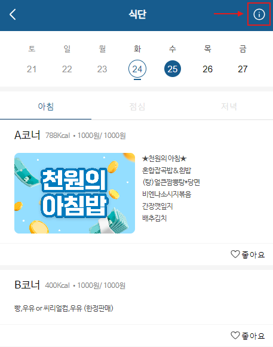
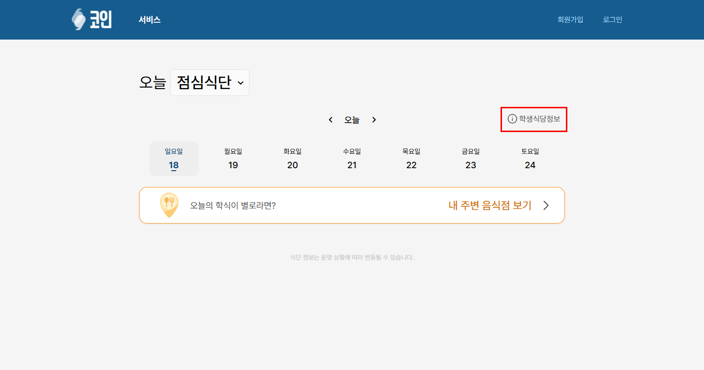
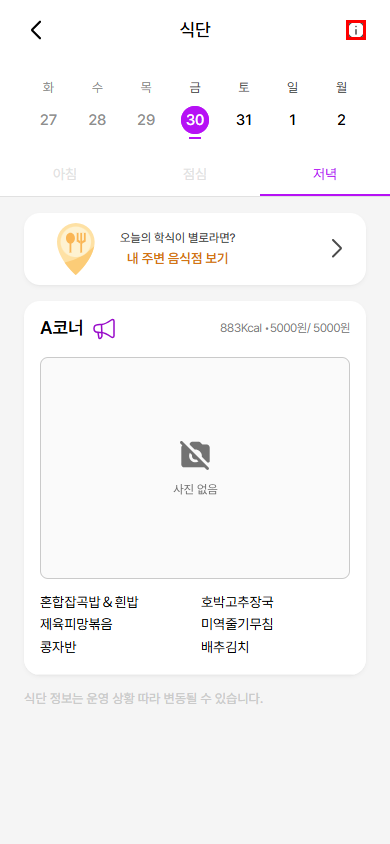

# 3-7. 식단_학생식당정보_클릭

원문 페이지 ID: 1370221954bc82008ede81bb956111a7

> 원문 스냅샷. 명세 확정·앱 배포·수집 완료를 뜻하지 않습니다.

## 원문 속성

```json
{
  "platform": [
    "ANDROID",
    "IOS",
    "WEB"
  ],
  "url": "source-page-id:1370221954bc82008ede81bb956111a7",
  "상태": "완료",
  "생성일": "2026-11-12T05:07:50.006Z",
  "이름": "3-7. 식단\\_학생식당정보\\_클릭",
  "태그": [
    "3. 식단 상세페이지"
  ]
}
```

<details>
<summary>과거 로깅</summary>


</details>

<details>
<summary>새 로깅</summary>

- 설명: 식단 화면에서 학생식당정보 버튼(모바일은 우측 상단 i 아이콘)을 클릭해 학생식당 운영 정보를 보는 경우
- screen\_view: <code>cafeteria</code>
- event\_name: <code>DA1</code>
- event\_label: <code>cafeteria__cafeteria__cafeteria_info__entry__click</code>
- value: 학생식당정보
- event\_category: <code>click</code>

### 참고사진 (학생식당정보 클릭)

<columns>
<column ratio="50">
<b>웹</b>

<b>참고사진 · 웹</b>

웹 — 학생식당정보 클릭 (출처: stage 실제 캡처, 빨간 네모 = 클릭 위치)


</column>
<column ratio="50">
<b>모바일</b>

<b>참고사진 · 모바일</b>





모바일 웹 · 2026-10-30 운영 보라색 식단 실제 화면. 빨간 테두리=우측 상단 학생식당정보 i 아이콘. 생성형 이미지가 아닌 실제 브라우저 캡처이며 네이티브 앱·SDK 발화는 미확인이다.

</column>
</columns>
</details>
