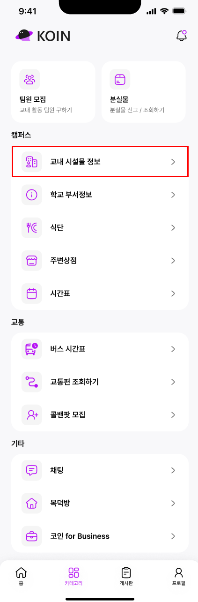

# [레거시] 10-3. 카테고리_교내 시설물 정보_클릭

원문 페이지 ID: 13a0221954bc82fa9bed81d79975357f

> 원문 스냅샷. 명세 확정·앱 배포·수집 완료를 뜻하지 않습니다.

## 원문 속성

```json
{
  "platform": [
    "ANDROID",
    "IOS"
  ],
  "url": "source-page-id:13a0221954bc82fa9bed81d79975357f",
  "상태": "레거시",
  "이름": "\\[레거시\\] 10-3. 카테고리\\_교내 시설물 정보\\_클릭",
  "태그": [
    "10. 헤더/푸터/햄버거_교내 시설물 정보"
  ]
}
```

<callout icon="📁" color="gray_bg">
<b>레거시·참조 명세 — 별도 구현 대상 아님</b>

- 2026-11-04 사용자 요청에 따라 중복·참조 관계를 정리했다. 교내 시설물 카테고리 진입의 현행 대표 명세는 [3-6 카테고리 내부 클릭 (현재 로깅) 2026.08.30 이후 찍히는 로깅](bb10221954bc8337aae781494584adee.md)이며 적용 라벨은 <code>facility__main_category__category_navigation__facility_entry__click</code>이다.
- 이 문서의 이전 label·value·category·event\_name·사진·플랫폼은 이력으로 보존한다. 아래 과거 ‘기준 명세’·‘별개 유지’ 설명보다 이 결정이 우선한다. 이 페이지를 근거로 이벤트를 추가 전송하지 않는다.
- 실제 SDK의 과거 호출 중단·새 라벨 전환·단일 전송은 개발 검증이 필요하다.
</callout>

<details>
<summary>이전 로깅</summary>

- 설명: 햄버거에서 교내 시설물 정보 클릭
- event\_label : “hamburger”
- value : “교내 시설물 정보”
- event\_category : “click”
- 참고사진


</details>

<details>
<summary>이관 전 새 로깅 (2026-10-15) — 수정 초안 — 레거시 보존</summary>

- 설명: 메인 카테고리 화면에서 ‘교내 시설물 정보’를 클릭한다.
- screen\_view: <code>main_category</code>
- event\_label: <code>facility__main_category__facility_entry__category_entry__click</code>
- event\_name: <code>DA2</code>
- event\_category: <code>click</code>
- value: 교내 시설물 정보

<details>
<summary>검토사항</summary>

- 통합 가이드·후속: [로깅 통합 가이드](3c30221954bc8214b1c481c5bbb6fba5.md)
- label 통일 (2026-10-27): <code>facility__main_category__facility_entry__category_entry</code> → <code>facility__main_category__facility_entry__category_entry__click</code>
- 변경 근거: 사용자 확인으로 기존 메뉴 디자인이 카테고리 화면으로 교체됨. 현행 명칭과 label의 세부 구간을 category로 통일한다. 과거 label과 원본 사진은 이전 로깅에 보존.
- 현행 대응 문서: [3-6 카테고리 내부 클릭 (현재 로깅) 2026.08.30 이후 찍히는 로깅](bb10221954bc8337aae781494584adee.md). 동일 기능이므로 중복 전송하지 않도록 실제 적용 지점을 하나로 정한다.
</details>

### 참고사진 (기능 표시)

<details>
<summary>참고사진 · 모바일</summary>

화면 정의에 제공된 카테고리 캡처. 해당 메뉴의 위치에 빨간 테두리만 추가. 이번 작업의 실제 Android 신규 캡처가 아님.


</details>
</details>
