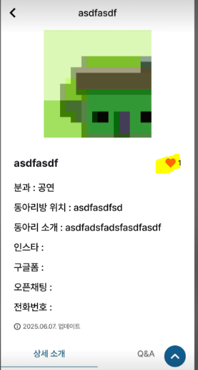
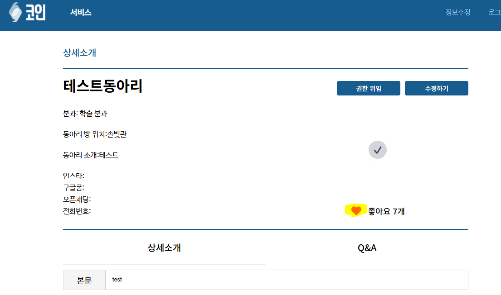

# 5-13.동아리_상세소개 좋아요 해제

원문 페이지 ID: 14c0221954bc82d087f681c98e3bd0b0

> 사용자 제공 ZIP 내보내기 보관본. 레거시·동결·검토 상태는 원문을 따르며 코드 생성 승인·앱 배포 완료를 뜻하지 않습니다.

platform: ANDROID, IOS, WEB
상태: 완료

- 설명: 동아리 상세소개 화면에서  이미 클릭한 빨간 하트모양 좋아요 버튼 클릭해서 해제 (로그인 유저만 로깅 적용)
- event_name : “CAMPUS”
- event_label : “club_introduction_like_cancel”
- value : “동아리명”
- event_category : “click”
- 참고사진

- 웹 참고사진

