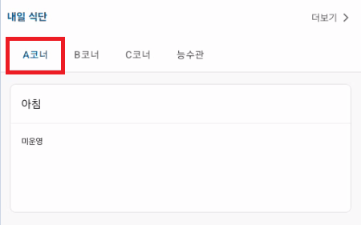
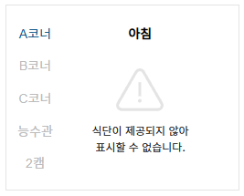
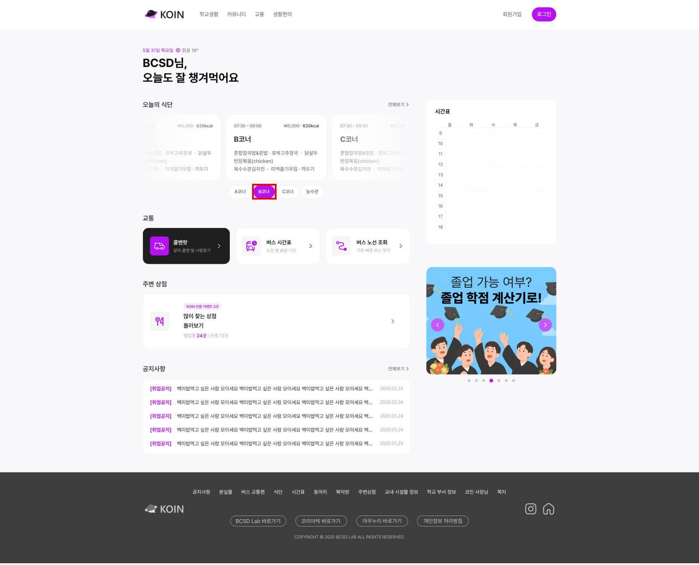
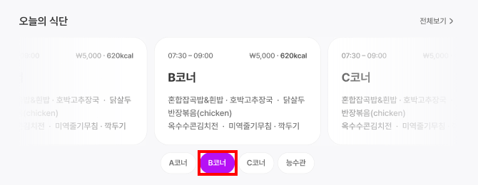
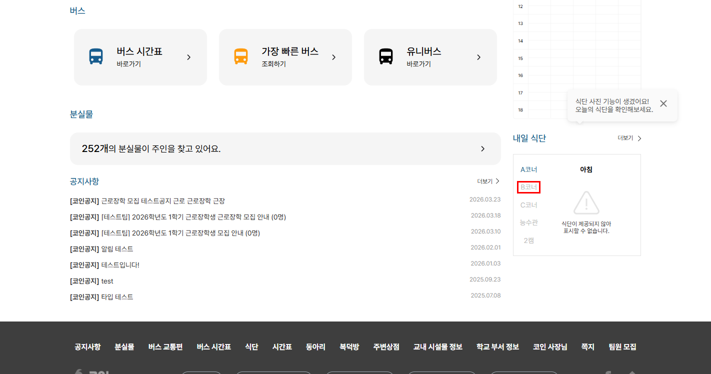
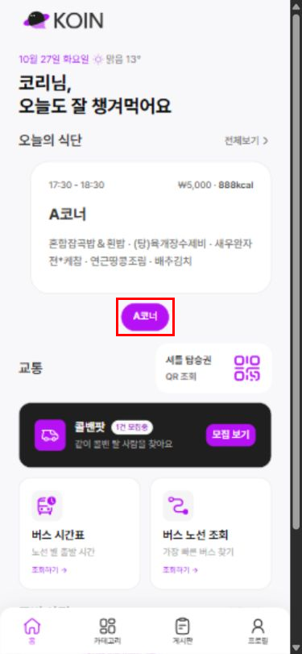

# 1-3.메인_식단_A코너_클릭 (레거시)

원문 페이지 ID: 1560221954bc83afacc8015e25700762

> 누락 원본 복구 스냅샷. 원본의 과거값·검토 기록을 보존하며 생성 계약으로 자동 승인하지 않습니다.

대조 기록: [87개 원본 복구 및 8개 차이 정리](../recovery-review.md)

관련 기존 보관본: [1-3.메인_식단_A코너_클릭 (레거시)](c250221954bc8318b85201e8c22f915d.md), [1-4 식단 코너 클릭](3220221954bc83549c970136b8786c33.md), [1-4 식단 코너 클릭](03a0221954bc82988da80160ab26ee4c.md), [3-1. 식단_식사시간 선택 (클릭) - 3-2·3-3 통합](1830221954bc82da965501008d23f1f3.md)

## 원문 속성

```json
{
  "platform": [
    "ANDROID",
    "IOS",
    "WEB"
  ],
  "url": "source-page-id:1560221954bc83afacc8015e25700762",
  "상태": "완료",
  "생성일": "2026-11-08T10:51:34.516Z",
  "이름": "1-3.메인\\_식단\\_A코너\\_클릭 (레거시)",
  "태그": [
    "1. 메인_식단"
  ]
}
```

<b>레거시 보존 · 현행 새 로깅은 홈으로 이관</b>

- 2026-11-04 사용자 지시로 이 페이지는 이력만 보존한다.
- 현행 기준 명세: [1-4 식단 코너 클릭](3220221954bc83549c970136b8786c33.md).
- 이관 후 event\_label: <code>main__main__corner__select</code>. 아래 이관 전 라벨·값·사진은 보존 기록이며 별도 신규 구현·추가 전송 대상으로 사용하지 않는다.
- 실제 SDK 전환·배포·수집 중단 여부는 미확인이다. 기존 플랫폼과 상태 속성은 유지했다.


<details>
<summary>이전 로깅</summary>


- 설명 : 메인화면에서 A코너 버튼 클릭
- event\_label : “main\_menu\_corner”
- value : “A코너<b>”</b>
- event\_category : “click”
- 참고사진





- 웹





</details>


<details>
<summary>이관 전 새 로깅 (26.10.17) — 레거시 보존</summary>


- 설명: 메인 화면 식단 위젯에서 코너 버튼(A코너 / B코너 / C코너 / 능수관 / 2캠퍼스)을 눌러 보이는 코너를 바꾸는 경우 (식단 화면으로 이동하지 않음). 1-3\~1-7 코너별 페이지를 이 라벨 하나로 합침
- screen\_view: <code>main</code>
- event\_name: <code>DA1</code>
- event\_label: <code>cafeteria__main__corner__select</code>
- value: \{코너\} → A코너 / B코너 / C코너 / 능수관 / 2캠퍼스 (예: B코너)
- event\_category: <code>select</code>

<details>
<summary>검토사항</summary>


- WEB 참고사진 반영 (2026-11-04 사용자 요청 정정): 아래 새 WEB 캡처와 빨간 네모·확대본을 기준으로 클릭 위치를 확인한다. 리디자인 전 WEB 사진은 이력으로 보존하며 모바일 사진·명세와 이전 로깅은 유지한다.
- WEB 리디자인 반영 (2026-11-04 사용자 승인): WEB: 리디자인 홈의 A/B/C코너·능수관 등 코너 선택으로 표시 내용을 바꾸는 경우 기존 corner/select 명세를 적용한다. ‘전체보기’ 페이지 진입과 구분한다. 기존 value 범위는 보존하되 2캠퍼스 버튼은 지정 Figma에서 확인되지 않았으므로 존재를 가정해 새 버튼/전송을 만들지 않는다. 모바일 정의는 유지한다.
- WEB 설계 근거: [Figma 참고 / 실제 화면 미확인](https://www.figma.com/design/DPlcYuiFxhyT5ULbqec59i/KOIN-Web?node-id=11541-33352). 기존 사진은 교체하지 않았으며 리디자인 화면의 위치 근거로 사용하지 않는다. SDK 구현·배포 시점·실제 수집은 미확인이다. 이 WEB 규정은 해당 화면의 과거 WEB 설명보다 우선하며 모바일·이전 로깅·기존 필드 값·DB 플랫폼 속성은 보존한다.
- 통합 가이드·후속: [로깅 통합 가이드](3c30221954bc8214b1c481c5bbb6fba5.md)
- 2캠퍼스 버튼은 웹만 있음 (모바일은 A/B/C코너, 능수관)
- 참고사진은 B코너 예시 / web. 모바일 참고사진 추가 완료 (stage 캡처에 빨간 네모, 2026-10-28)

</details>


### 참고사진 (메인 식단 코너 선택)

<b>웹</b>

<details>
<summary>참고사진 · 웹</summary>


WEB 리디자인 · [Figma 시안](https://www.figma.com/design/DPlcYuiFxhyT5ULbqec59i/KOIN-Web?node-id=11541-33352) · 2026-11-04. 빨간 네모는 이 명세의 클릭 위치다. 원본 캡처에 코드로 테두리만 표시했으며 실제 서비스 캡처·배포 완료를 의미하지 않는다. B코너 선택 예시이며 전체보기 버튼과 구분한다.

<b>전체 화면</b>





<b>클릭 위치 확대</b>





<details>
<summary>이전 WEB 참고사진 (리디자인 전)</summary>


웹 — 메인 식단 코너 선택, 예: B코너 (출처: stage 실제 캡처, 빨간 네모 = 클릭 위치)





</details>


</details>


<b>모바일</b>

<details>
<summary>참고사진 · 모바일</summary>





WEB (모바일) · 빨간 네모: 코너 선택 버튼 클릭. stage 실제 화면 캡처에 위치 표시.


</details>


</details>
