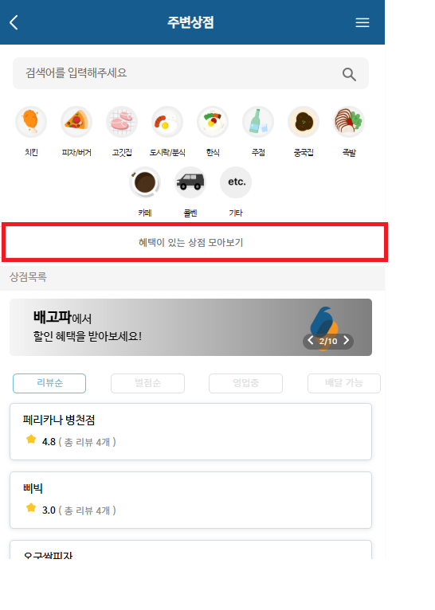

# 4-3 카테고리에서 혜택페이지(클릭) 

원문 페이지 ID: 1600221954bc83918f5e8130d81e2641

> 원문 스냅샷. 명세 확정·앱 배포·수집 완료를 뜻하지 않습니다.

## 원문 속성

```json
{
  "platform": [
    "WEB",
    "ANDROID",
    "IOS"
  ],
  "url": "source-page-id:1600221954bc83918f5e8130d81e2641",
  "상태": "완료",
  "생성일": "2026-11-08T10:51:54.182Z",
  "이벤트 이름": "<p>\n4-3 카테고리에서 혜택페이지(클릭) \n</p>",
  "태그": [
    "99. 혜택 페이지"
  ]
}
```


<span color="orange">event\_params.key</span>

<ul>
<li>
event\_label : shop\_categories\_benefit
</li>
<li>
value : 혜택이 있는 상점 모아보기
</li>
<li>
event\_category : click <br />
</li>
<li>
previous\_page : \{이전카테고리\}
</li>
<li>
current\_page : benefit
</li>
<li>
duration\_time : 이전 카테고리에서 현 카테고리로 이동하는 시간 
</li>
</ul>





