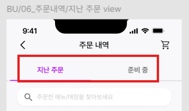

# 9-1 주문내역 상단 탭

원문 페이지 ID: 1680221954bc82a1a88d010f2e6fb6ca

> 원문 스냅샷. 명세 확정·앱 배포·수집 완료를 뜻하지 않습니다.

## 원문 속성

```json
{
  "platform": [
    "ANDROID",
    "IOS"
  ],
  "url": "source-page-id:1680221954bc82a1a88d010f2e6fb6ca",
  "상태": "로깅 필요",
  "생성일": "2026-11-08T10:51:33.349Z",
  "이벤트 이름": "9-1 주문내역 상단 탭",
  "태그": [
    "9. 주문내역 페이지"
  ]
}
```





<span color="orange">event\_params.key</span>

<ul>
<li>
event\_label : orderHistory\_tabClick
</li>
<li>
value : 

- Past Orders
- Preparing
</li>
<li>
event\_category : click
</li>
<li>
previous\_page :
</li>
<li>
current\_page :
</li>
<li>
duration\_time :
</li>
</ul>


