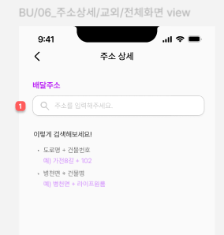

# 7-9 결제 → 교외 주문 페이지 주소 검색 클릭(6월 29일 수정)

원문 페이지 ID: 16a0221954bc832f9272016f854d8125

> 원문 스냅샷. 명세 확정·앱 배포·수집 완료를 뜻하지 않습니다.

## 원문 속성

```json
{
  "platform": [
    "WEB"
  ],
  "url": "source-page-id:16a0221954bc832f9272016f854d8125",
  "상태": "로깅 필요",
  "생성일": "2026-11-08T10:51:56.082Z",
  "이벤트 이름": "7-9 결제 → 교외 주문 페이지 주소 검색 클릭(6월 29일 수정)"
}
```




주소 창을 클릭했을 때 발생하는 로깅입니다


<span color="orange">event\_params.key</span>

<ul>
<li>
event\_label : payment\_off\_campus\_addressSearch
</li>
<li>
value : 
</li>
<li>
event\_category : 

<ul>
<li>
click 
</li>
</ul>


</li>
</ul>
