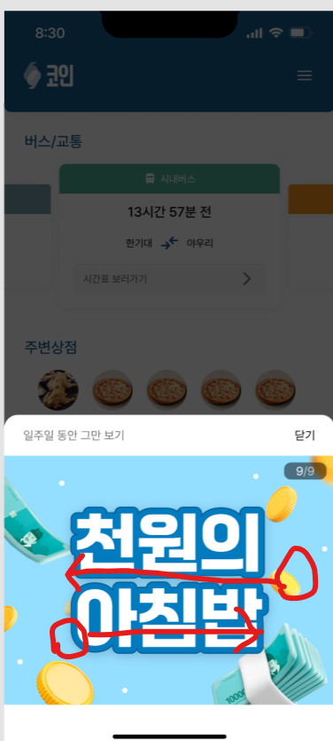
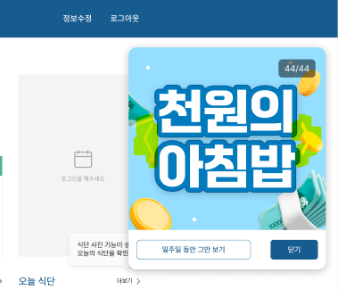
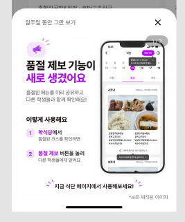

# 1-5. (모바일)메인_다음모달 - swipe

원문 페이지 ID: 16c0221954bc82e6b0bb8135f8eb1628

> 원문 스냅샷. 명세 확정·앱 배포·수집 완료를 뜻하지 않습니다.

## 원문 속성

```json
{
  "platform": [
    "ANDROID",
    "IOS"
  ],
  "url": "source-page-id:16c0221954bc82e6b0bb8135f8eb1628",
  "상태": "로깅 필요",
  "이름": "1-5. (모바일)메인\\_다음모달 - swipe",
  "태그": [
    "1. 메인_모달"
  ]
}
```

<details>
<summary>과거 로깅</summary>

- 설명: 메인화면 모달의 다음 모달로 스왑
- event\_name : “CAMPUS”
- event\_label : “main\_next\_modal”
- value : \{title값\} (넘긴 후의)
- event\_category : “swipe”
- 참고사진



- 웹 참고사진


</details>

<details>
<summary>새 로깅</summary>

- 설명: 메인 화면의 배너 모달을 스와이프하여 다음 배너로 넘김.
- screen\_view: main
- event\_name: <code>DA2</code>
- event\_label: <code>banner__main__modal__next__swipe</code>
- value: \{넘긴 후의 배너 ID\}
- event\_category: <code>swipe</code>

<b>참고사진 · 모바일</b>

<b>모바일</b>


</details>
