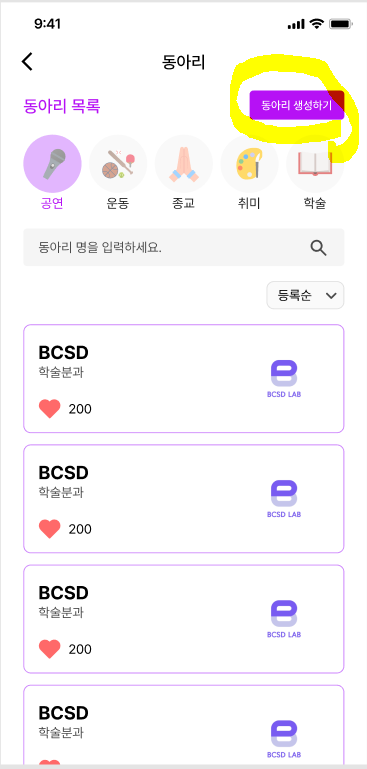
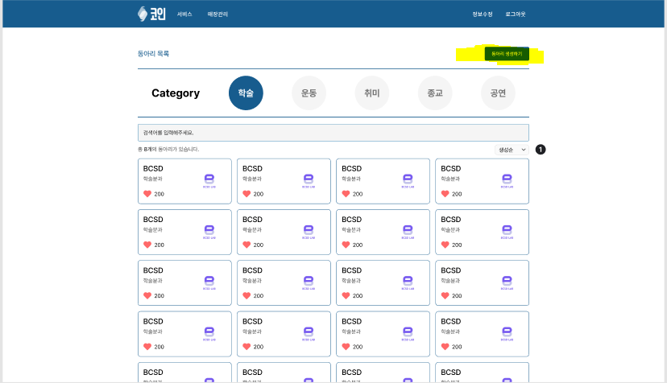

# 2-2.동아리_동아리 생성하기 클릭

원문 페이지 ID: 1750221954bc821f956681a964404728

> 필터 밖 원본 행 복구 스냅샷. 중복·빈 페이지도 원본 ID와 속성, 본문을 개별 보존합니다. 명세 승인이나 앱 적용 완료를 뜻하지 않습니다.

대조 기록: [숨겨진 원본 42개 복구](../hidden-recovery.md)

관련 기존 보관본: [레거시 2-2.동아리_동아리 생성하기 클릭](b940221954bc83b39cd801f75a1c20db.md), [레거시 2-2.동아리_동아리 생성하기 클릭](a120221954bc828cbf43810d5fc2e7a7.md)

## 원문 속성

```json
{
  "platform": [
    "WEB",
    "ANDROID",
    "IOS"
  ],
  "url": "source-page-id:1750221954bc821f956681a964404728",
  "상태": "완료",
  "이름": "2-2.동아리\\_동아리 생성하기 클릭"
}
```

<ul>
<li>
설명: 동아리 메인화면에서 동아리 생성하기 클릭 (로그인 유저만 로깅 적용)
</li>
<li>
event\_name : “CAMPUS”
</li>
<li>
event\_label : “club\_main\_create”
</li>
<li>
value : “생성하기”
</li>
<li>
event\_category : “click” 
</li>
<li>
참고사진
</li>
</ul>





- 웹 참고사진



