# 4-2. 모집글 편집

원문 페이지 ID: 17c0221954bc824ea9b881ebaeadff79

> 원문 스냅샷. 명세 확정·앱 배포·수집 완료를 뜻하지 않습니다.

## 원문 속성

```json
{
  "platform": [
    "WEB",
    "ANDROID",
    "IOS"
  ],
  "url": "source-page-id:17c0221954bc824ea9b881ebaeadff79",
  "구분": "모집글 상세 작성자",
  "상태": "로깅 필요",
  "생성일": "2026-11-08T10:52:11.842Z",
  "이벤트 이름": "4-2. 모집글 편집"
}
```


<details>
<summary>이전 로깅</summary>

게시글 편집 버튼 클릭

<ul>
<li>
event\_label : team\_recruitment\_post\_edit
</li>
<li>
value : 편집하기 
</li>
<li>
event\_category : click
</li>
</ul>

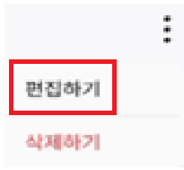

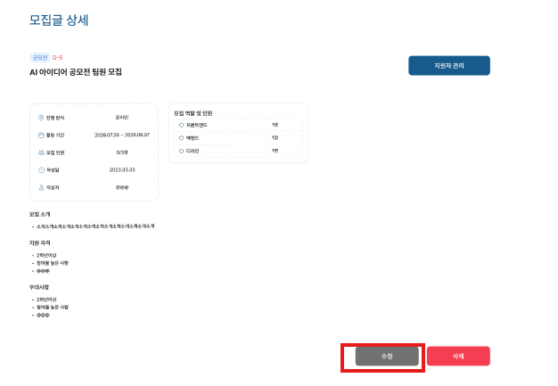

① 카테고리 선택

- event\_label : team\_recruitment\_post\_edit\_category
- value : \{공모전 / 대외활동 / 스터디 / 프로젝트 / 기타\}
- event\_category : click

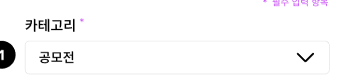

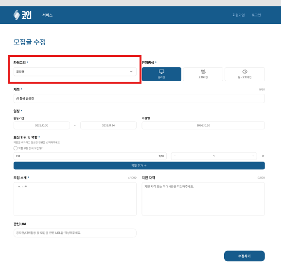

② 진행 방식 선택

- event\_label : team\_recruitment\_post\_edit\_method
- value : \{온라인 / 오프라인 / 온·오프라인\}
- event\_category : click

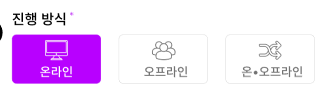

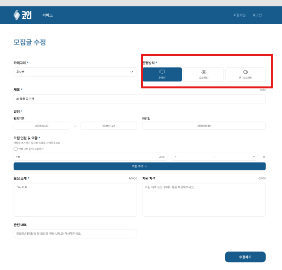

③ 역할

- event\_label : team\_recruitment\_post\_edit\_role
- value : \{역할 구분 없이 모집하기 / 역할 추가\}
- event\_category : click

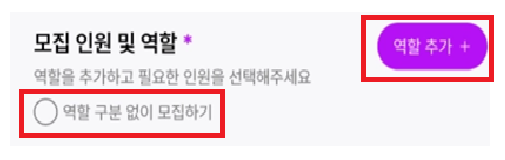

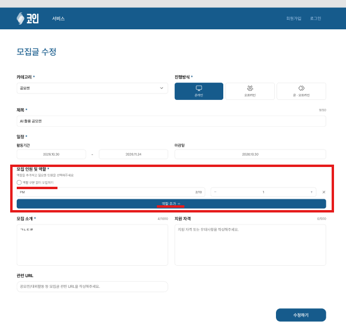

④ 수정 완료 버튼 클릭

- event\_label : team\_recruitment\_post\_edit\_submit
- value : 수정 완료
- event\_category : click

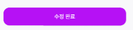

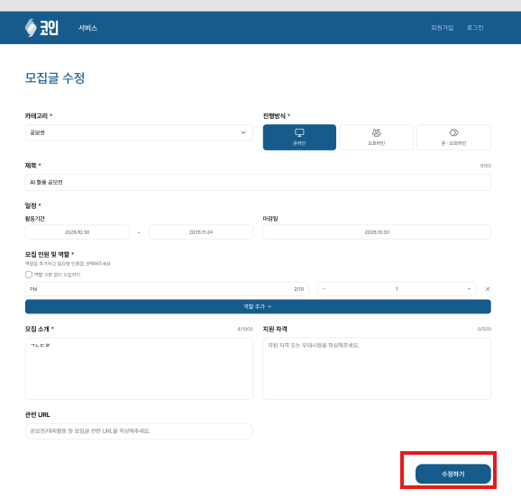

⑤ 수정 취소하기

- event\_label : team\_recruitment\_post\_edit\_submit\_cancel
- value : 취소하기
- event\_category : click

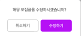

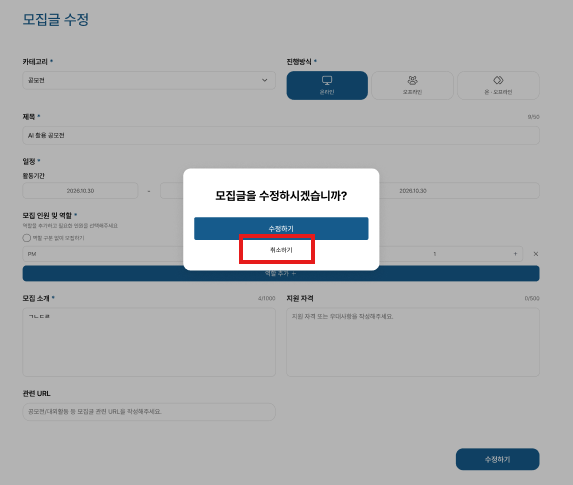

⑥ 수정하기

- event\_label : team\_recruitment\_post\_edit\_submit\_confirm
- value : 수정하기
- event\_category : click


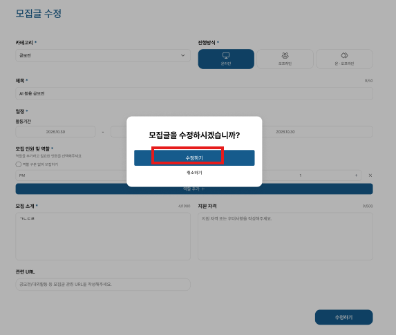
</details>

<details>
<summary>새 로깅 (26.10.17)</summary>

게시글 편집 버튼 클릭

- 설명: 내가 작성한 모집글의 상세 화면에서 편집 버튼을 클릭해 모집글 편집 화면으로 들어가는 경우
- screen\_view: <code>team_detail</code>
- event\_name: <code>DA1</code>
- event\_label: <code>team_recruit__team_detail__team_edit__entry__click</code>
- value: 편집하기
- event\_category: <code>click</code>

① 카테고리 선택

- 설명: 모집글 편집 화면에서 카테고리(공모전 / 대외활동 / 스터디 / 프로젝트 / 기타) 중 하나를 고르는 경우
- screen\_view: <code>team_edit</code>
- event\_name: <code>DA1</code>
- event\_label: <code>team_recruit__team_edit__team_edit__category__select</code>
- value: \{공모전 / 대외활동 / 스터디 / 프로젝트 / 기타\} (예: 스터디)
- event\_category: <code>select</code>

② 진행 방식 선택

- 설명: 모집글 편집 화면에서 진행 방식(온라인 / 오프라인 / 온·오프라인) 중 하나를 고르는 경우
- screen\_view: <code>team_edit</code>
- event\_name: <code>DA1</code>
- event\_label: <code>team_recruit__team_edit__team_edit__method__select</code>
- value: \{온라인 / 오프라인 / 온·오프라인\} (예: 온라인)
- event\_category: <code>select</code>

③ 역할

- 설명: 모집글 편집 화면의 모집 역할 영역에서 역할 추가 또는 역할 구분 없이 모집하기 버튼을 클릭하는 경우
- screen\_view: <code>team_edit</code>
- event\_name: <code>DA1</code>
- event\_label: <code>team_recruit__team_edit__team_edit__role__click</code>
- value: \{역할 구분 없이 모집하기 / 역할 추가\} (예: 역할 추가)
- event\_category: <code>click</code>

④ 수정 완료 버튼 클릭

- 설명: 모집글 편집 화면 하단의 수정 완료 버튼을 클릭해 수정 확인 팝업을 여는 경우
- screen\_view: <code>team_edit</code>
- event\_name: <code>DA1</code>
- event\_label: <code>team_recruit__team_edit__team_edit__open__click</code>
- value: 수정 완료
- event\_category: <code>click</code>

⑤ 수정 취소하기

- 설명: 수정 확인 팝업에서 취소하기를 클릭해 팝업을 닫는 경우
- screen\_view: <code>team_edit</code>
- event\_name: <code>DA1</code>
- event\_label: <code>team_recruit__team_edit__team_edit__cancel__click</code>
- value: 취소하기
- event\_category: <code>click</code>

⑥ 수정하기

- 설명: 수정 확인 팝업에서 수정하기를 클릭해 모집글 수정을 최종 저장하는 경우
- screen\_view: <code>team_edit</code>
- event\_name: <code>DA1</code>
- event\_label: <code>team_recruit__team_edit__team_edit__confirm__click</code>
- value: 수정하기
- event\_category: <code>click</code>

<details>
<summary>검토사항</summary>

- 통합 가이드·후속: [로깅 통합 가이드](3c30221954bc8214b1c481c5bbb6fba5.md)
- ⑤ ⑥ 참고사진: 수정 확인 팝업은 수정 완료를 눌러야 열려서, stage 데이터 보호를 위해 캡처하지 않음
- label DA2 기준 정렬 (2026-10-27): <code>team_recruit__team_detail__edit__click</code> → <code>team_recruit__team_detail__team_edit__entry__click</code>
- label DA2 기준 정렬 (2026-10-27): <code>team_recruit__team_edit__category__select</code> → <code>team_recruit__team_edit__team_edit__category__select</code>
- label DA2 기준 정렬 (2026-10-27): <code>team_recruit__team_edit__method__select</code> → <code>team_recruit__team_edit__team_edit__method__select</code>
- label DA2 기준 정렬 (2026-10-27): <code>team_recruit__team_edit__role__click</code> → <code>team_recruit__team_edit__team_edit__role__click</code>
- label DA2 기준 정렬 (2026-10-27): <code>team_recruit__team_edit__submit__click</code> → <code>team_recruit__team_edit__team_edit__open__click</code>
- label DA2 기준 정렬 (2026-10-27): <code>team_recruit__team_edit__submit__cancel__click</code> → <code>team_recruit__team_edit__team_edit__cancel__click</code>
- label DA2 기준 정렬 (2026-10-27): <code>team_recruit__team_edit__submit__confirm__click</code> → <code>team_recruit__team_edit__team_edit__confirm__click</code>
- 사진은 stage 로그인 상태 캡처 (편집 버튼은 우측 상단 ⋮ 메뉴를 연 상태, ①은 카테고리 드롭다운을 연 상태). 사진 플랫폼 확인 완료 (이미지 비율 기준: 모바일, 780x1688). 웹 사진 추가 필요
</details>

### 참고사진 (모집글 편집)

게시글 편집 버튼 클릭

<columns>
<column ratio="50">
<b>웹</b>

<details>
<summary>참고사진 · 웹</summary>

웹 — 사진 없음 (추가 필요)
</details>
</column>
<column ratio="50">
<b>모바일</b>

<details>
<summary>참고사진 · 모바일</summary>

모바일 — 편집 버튼 (출처: stage 실제 캡처, 빨간 네모 = 클릭 위치)

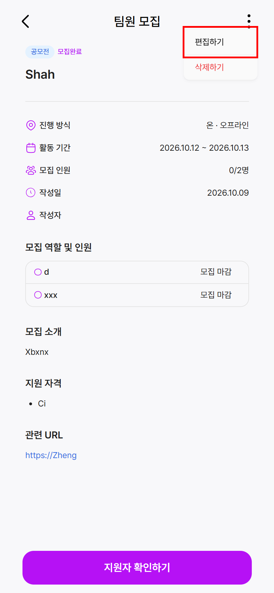
</details>
</column>
</columns>

① 카테고리 선택

<columns>
<column ratio="50">
<b>웹</b>

<details>
<summary>참고사진 · 웹</summary>

웹 — 사진 없음 (추가 필요)
</details>
</column>
<column ratio="50">
<b>모바일</b>

<details>
<summary>참고사진 · 모바일</summary>

모바일 — 카테고리 선택 (출처: stage 실제 캡처, 빨간 네모 = 클릭 위치)

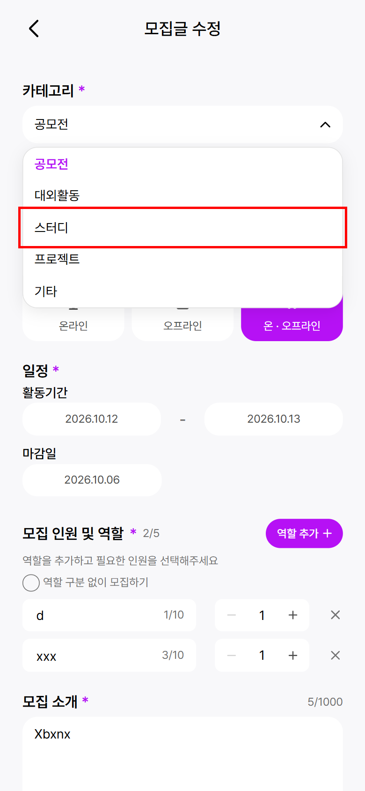
</details>
</column>
</columns>

② 진행 방식 선택

<columns>
<column ratio="50">
<b>웹</b>

<details>
<summary>참고사진 · 웹</summary>

웹 — 사진 없음 (추가 필요)
</details>
</column>
<column ratio="50">
<b>모바일</b>

<details>
<summary>참고사진 · 모바일</summary>

모바일 — 진행 방식 선택 (출처: stage 실제 캡처, 빨간 네모 = 클릭 위치)

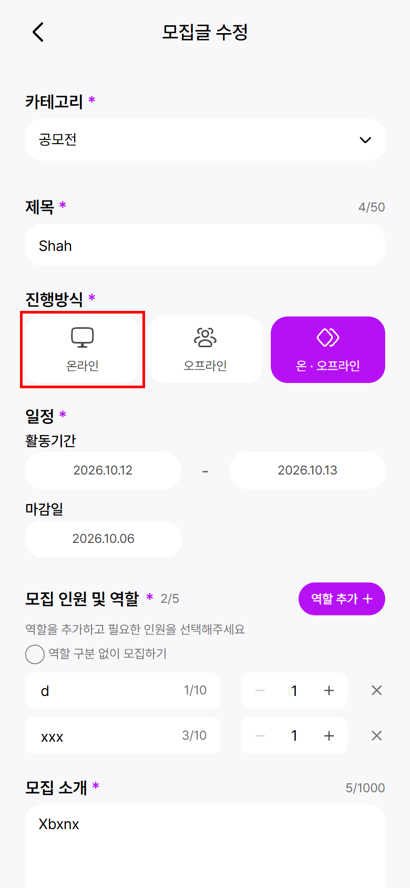
</details>
</column>
</columns>

③ 역할

<columns>
<column ratio="50">
<b>웹</b>

<details>
<summary>참고사진 · 웹</summary>

웹 — 사진 없음 (추가 필요)
</details>
</column>
<column ratio="50">
<b>모바일</b>

<details>
<summary>참고사진 · 모바일</summary>

모바일 — 역할 (출처: stage 실제 캡처, 빨간 네모 = 클릭 위치)

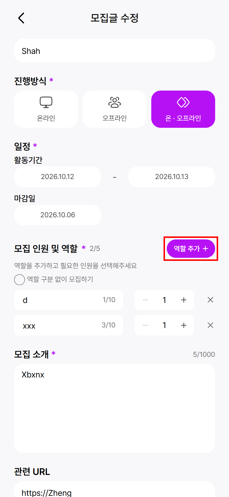
</details>
</column>
</columns>

④ 수정 완료 버튼 클릭

<columns>
<column ratio="50">
<b>웹</b>

<details>
<summary>참고사진 · 웹</summary>

웹 — 사진 없음 (추가 필요)
</details>
</column>
<column ratio="50">
<b>모바일</b>

<details>
<summary>참고사진 · 모바일</summary>

모바일 — 수정 완료 버튼 (출처: stage 실제 캡처, 빨간 네모 = 클릭 위치)

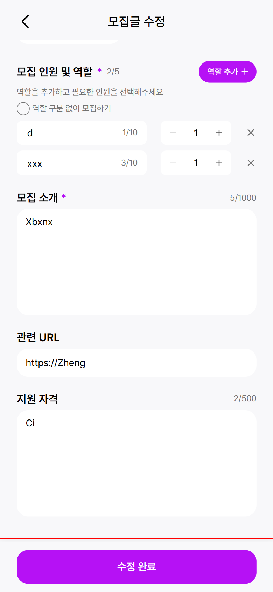
</details>
</column>
</columns>

⑤ 수정 취소하기

<columns>
<column ratio="50">
<b>웹</b>

<details>
<summary>참고사진 · 웹</summary>

웹 — 사진 없음 (추가 필요)
</details>
</column>
<column ratio="50">
<b>모바일</b>

<details>
<summary>참고사진 · 모바일</summary>

모바일 — 사진 없음 (추가 필요)
</details>
</column>
</columns>

⑥ 수정하기

<columns>
<column ratio="50">
<b>웹</b>

<details>
<summary>참고사진 · 웹</summary>

웹 — 사진 없음 (추가 필요)
</details>
</column>
<column ratio="50">
<b>모바일</b>

<details>
<summary>참고사진 · 모바일</summary>

모바일 — 사진 없음 (추가 필요)
</details>
</column>
</columns>
</details>
