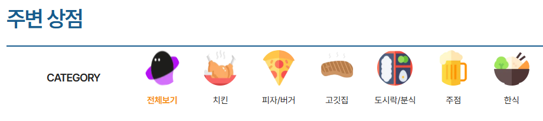
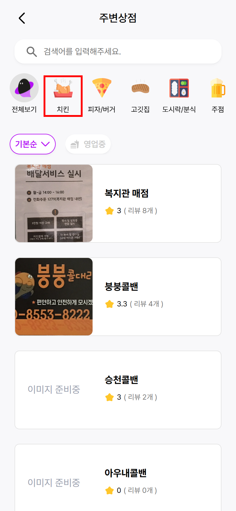

# 2-1 상점 카테고리 → 상점 카테고리 (클릭) 

원문 페이지 ID: 17c0221954bc82578ec501af435d0b86

> 원문 스냅샷. 명세 확정·앱 배포·수집 완료를 뜻하지 않습니다.

## 원문 속성

```json
{
  "platform": [
    "WEB",
    "ANDROID",
    "IOS"
  ],
  "url": "source-page-id:17c0221954bc82578ec501af435d0b86",
  "상태": "완료",
  "생성일": "2026-11-12T05:07:37.230Z",
  "이벤트 이름": "<p>\n2-1 상점 카테고리 → 상점 카테고리 (클릭) \n</p>",
  "태그": [
    "2. 상점 카테고리"
  ]
}
```

<details>
<summary>과거 로깅</summary>

<span color="orange">event\_params.key</span>

<ul>
<li>
event\_label : shop\_categories
</li>
<li>
value : \{카테고리\}    (들어간 카테고리)
</li>
<li>
event\_category : click <br />
</li>
<li>
previous\_page : \{이전 카테고리\}
</li>
<li>
current\_page : \{현 카테고리\}
</li>
<li>
duration\_time : 이전 카테고리에서 현 카테고리로 이동하는 시간 
</li>
</ul>


<h3>
오류 사항 
</h3>

<p>
웹: 
</p>

<p>
헤더나 푸터를 이용하여 들어온뒤 카테고리를 이동하면 scroll in 값이 뜨고 있습니다. 
</p>


---

<p>
IOS 
</p>

[해결 (1)](1060221954bc8278b7ca81824968cf3c.md)
</details>

<details>
<summary>새 로깅</summary>

- 설명: 카테고리를 선택해서 주변 상점에 진입 후 또 다른 카테고리를 선택하는 경우
- screen\_view: <code>shop_list</code>
- event\_name: <code>DA1</code>
- event\_label: <code>shop__shop_list__filter__category__click</code>
- value: \{사용자가 클릭한 카테고리\} → 혜택 / 치킨 / 피자/버거 등 (예: 치킨)
- event\_category: <code>click</code>

### 참고사진 (카테고리 → 카테고리 클릭)

<columns>
<column ratio="50">
<b>웹</b>

<b>참고사진 · 웹</b>

웹 — 상점 카테고리 이동 클릭 (출처: 기존 캡처)


</column>
<column ratio="50">
<b>모바일</b>

<b>참고사진 · 모바일</b>

모바일 — 상점 카테고리 이동 클릭 (출처: stage 실제 캡처, 빨간 네모 = 클릭 위치)


</column>
</columns>
</details>
