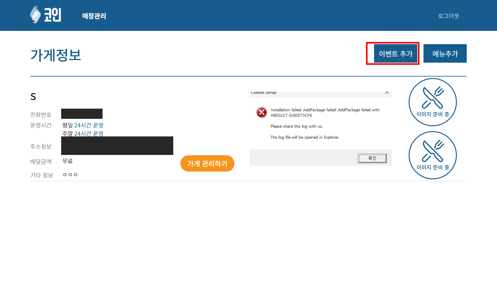

# 1-1 이벤트 추가 

원문 페이지 ID: 1800221954bc839585c581b56cc66536

> 원문 스냅샷. 명세 확정·앱 배포·수집 완료를 뜻하지 않습니다.

## 원문 속성

```json
{
  "platform": [
    "WEB"
  ],
  "url": "source-page-id:1800221954bc839585c581b56cc66536",
  "상태": "완료",
  "생성일": "2026-11-12T05:07:39.196Z",
  "이벤트 이름": "<p>\n1-1 이벤트 추가 \n</p>",
  "태그": [
    "1. 이벤트 추가"
  ]
}
```

<details>
<summary>과거 로깅</summary>

<span color="orange">event\_params.key</span>

- event\_label : add\_event
- value : 이벤트 추가
- event\_category : click


</details>

<details>
<summary>새 로깅</summary>

- 설명: 사장님 가게 정보 화면(/owner)에서 이벤트 추가(또는 이벤트 영역의 추가하기) 버튼을 클릭해 이벤트 추가 화면으로 들어가는 경우
- screen\_view: <code>owner_shop</code>
- event\_name: <code>DA1</code>
- event\_label: <code>owner__owner_shop__shop_event_manage__add_entry__click</code>
- value: 이벤트 추가
- event\_category: <code>click</code>

### 참고사진 (헤더의 이벤트 추가 버튼)

<columns>
<column ratio="50">
<b>웹</b>

<b>참고사진 · 웹</b>

웹 — 이벤트 추가 버튼 (출처: stage 실제 캡처, 빨간 네모 = 클릭 위치)


</column>
<column ratio="50">
<b>모바일</b>

<b>참고사진 · 모바일</b>

모바일 — 해당 없음 (웹 전용)
</column>
</columns>
</details>
