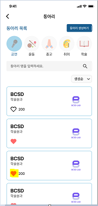
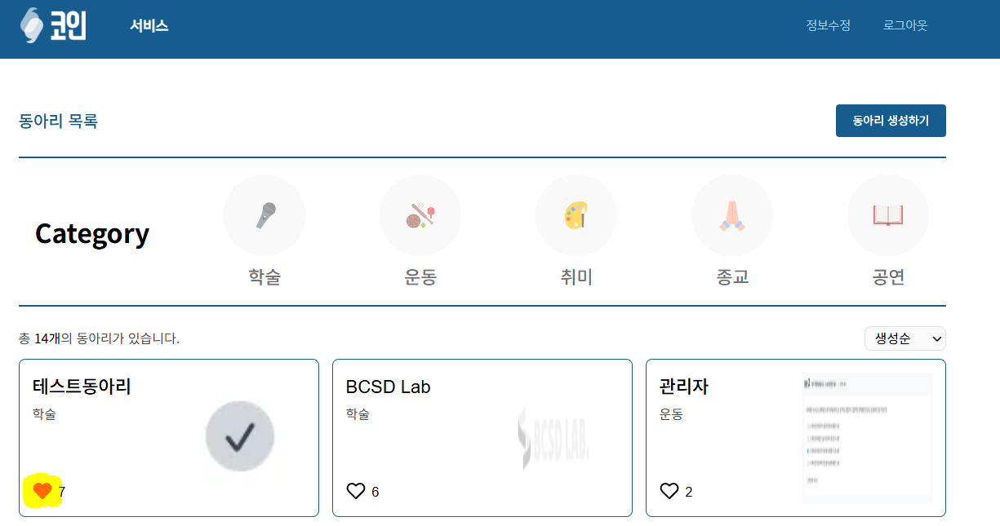

# 2-5.동아리_동아리 메인화면 좋아요 해제

원문 페이지 ID: 1890221954bc82a8a3b28142a0a0e8f8

> 사용자 제공 ZIP 내보내기 보관본. 레거시·동결·검토 상태는 원문을 따르며 코드 생성 승인·앱 배포 완료를 뜻하지 않습니다.

platform: ANDROID, IOS, WEB
상태: 완료

- 설명: 동아리 메인화면에서 특정 동아리의 빨간 하트모양 좋아요 버튼 클릭 (로그인 유저만 로깅 적용)
- event_name : “CAMPUS”
- event_label : “club_main_like_cancel”
- value : “동아리명”
- event_category : “click”
- 참고사진

- 웹 참고사진

