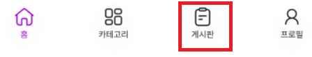
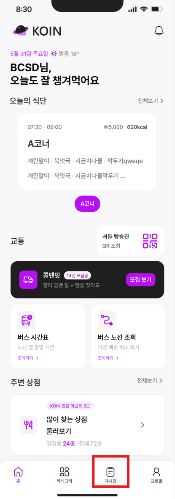

# 2-3 네비게이션 바 게시판 클릭

원문 페이지 ID: 1a20221954bc82d79fd201b4a3b66841

> 원문 스냅샷. 명세 확정·앱 배포·수집 완료를 뜻하지 않습니다.

## 원문 속성

```json
{
  "platform": [
    "ANDROID",
    "IOS",
    "WEB (모바일)"
  ],
  "url": "source-page-id:1a20221954bc82d79fd201b4a3b66841",
  "구분": "네비게이션 바",
  "상태": "완료",
  "생성일": "2026-11-12T05:08:01.167Z",
  "이벤트 이름": "2-3 네비게이션 바 게시판 클릭"
}
```

<details>
<summary>과거 로깅</summary>

- event\_label : nav\_bulletin
- value : 게시판
- event\_category : click





</details>

<details>
<summary>새 로깅</summary>

- 설명: 앱 하단 네비게이션 바에서  공지사항(게시판) 항목 클릭.
- screen\_view: <code>main</code>
- event\_name: <code>DA2</code>
- event\_label: <code>main__main__notice_entry__navigation_entry__click</code>
- value: 공지사항
- event\_category: <code>click</code>

### 참고사진 (하단 게시판 클릭)

<b>웹</b>

<b>참고사진 · 웹</b>

<b>리디자인 시안에서 미확인 — WEB 클릭 사진 없음</b>

리디자인 데스크톱 WEB에는 하단 게시판 탭이 확인되지 않는다. 이 명세는 이관 원본처럼 ANDROID·IOS 하단 내비게이션에 적용한다. 새 홈 공지사항 영역이나 헤더 커뮤니티 메뉴와 같은 이벤트로 간주하지 않는다.

[Figma 홈 리디자인](https://www.figma.com/design/DPlcYuiFxhyT5ULbqec59i/KOIN-Web?node-id=11541-33352)

<b>모바일</b>

<b>참고사진 · 모바일</b>

<b>모바일</b>




</details>
