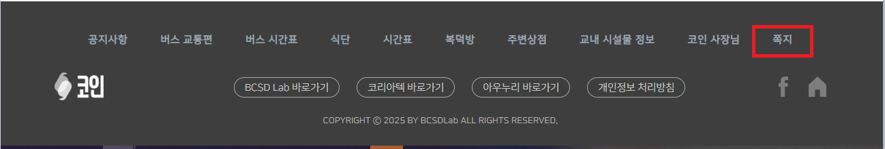

# 11-19.푸터_쪽지_클릭

원문 페이지 ID: 1a70221954bc83408a1381789c552b4f

> 원문 스냅샷. 명세 확정·앱 배포·수집 완료를 뜻하지 않습니다.

## 원문 속성

```json
{
  "platform": [
    "WEB"
  ],
  "url": "source-page-id:1a70221954bc83408a1381789c552b4f",
  "상태": "완료",
  "이름": "11-19.푸터\\_쪽지\\_클릭",
  "태그": [
    "11.분실물"
  ]
}
```

<details>
<summary>과거 로깅</summary>

- 설명:  웹 페이지 푸터 에서 쪽지 버튼 클릭
- event\_label : “footer”
- value : “쪽지”
- event\_category : “click”
- 참고사진


WEB




</details>

<details>
<summary>새 로깅</summary>

- 구체적 발생 조건: 웹의 공용 영역에서 하단 푸터에서 ‘쪽지’를 클릭한다.
- screen\_view: <code>footer</code>
- event\_label: <code>chat__footer__chat_entry__footer_entry__click</code>
- event\_name: <code>DA2</code>
- event\_category: <code>click</code>
- value: 쪽지

### 참고사진 (WEB 리디자인 · 푸터 쪽지)

<b>웹</b>

<b>참고사진 · 웹</b>

[Figma 원본](https://www.figma.com/design/DPlcYuiFxhyT5ULbqec59i/KOIN-Web?node-id=17664-28870) · 2026-11-04. 원본 캡처에 빨간 네모만 추가했다. 빨간 네모는 기존 명세의 쪽지 클릭 위치다. 실제 SDK 적용·배포·전송은 미확인이다.


</details>
