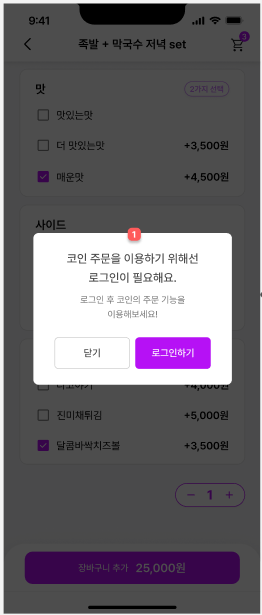

# 6-13 장바구니 비로그인 모달

원문 페이지 ID: 1aa0221954bc82cdaa5301f4d6986652

> 원문 스냅샷. 명세 확정·앱 배포·수집 완료를 뜻하지 않습니다.

## 원문 속성

```json
{
  "platform": [
    "ANDROID",
    "IOS"
  ],
  "url": "source-page-id:1aa0221954bc82cdaa5301f4d6986652",
  "상태": "로깅 필요",
  "생성일": "2026-11-12T05:07:46.866Z",
  "이벤트 이름": "6-13 장바구니 비로그인 모달",
  "태그": [
    "6. 장바구니 페이지"
  ]
}
```




<span color="orange">event\_params.key</span>

<ul>
<li>
event\_label : cart\_login\_modal
</li>
<li>
value : 

- O
- X
</li>
<li>
event\_category : 

<ul>
<li>
click 
</li>
</ul>
</li>
</ul>
