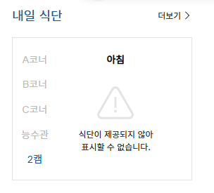

# 1-7.메인_식단_2캠퍼스_클릭

원문 페이지 ID: 1ae0221954bc834388268145704074e0

> 누락 원본 복구 스냅샷. 원본의 과거값·검토 기록을 보존하며 생성 계약으로 자동 승인하지 않습니다.

대조 기록: [87개 원본 복구 및 8개 차이 정리](../recovery-review.md)

관련 기존 보관본: [1-7.메인_식단_2캠퍼스_클릭](15e0221954bc835a969901001f9897ae.md)

## 원문 속성

```json
{
  "platform": [
    "WEB"
  ],
  "url": "source-page-id:1ae0221954bc834388268145704074e0",
  "상태": "완료",
  "생성일": "2026-11-08T10:51:36.005Z",
  "이름": "1-7.메인\\_식단\\_2캠퍼스\\_클릭",
  "태그": [
    "1. 메인_식단"
  ]
}
```

<details>
<summary>이전 로깅</summary>


- 설명 : 메인화면에서 2캠퍼스 버튼 클릭
- event\_label : “main\_menu\_corner”
- value : “2캠퍼스<b>”</b>
- event\_category : “click”
- 참고사진
- 웹





</details>


<details>
<summary>새 로깅 (26.10.17)</summary>


- 레거시: 코너별로 나뉘어 있던 메인 식단 코너 클릭을 1-3 하나의 라벨로 합치고 코너는 value로 구분한다(2캠퍼스도 value). 새 로깅을 만들지 않는다.
- 대체 로깅 : 1-3.메인\_식단\_A코너\_클릭 (cafeteria\_\_main\_\_corner\_\_select)

<details>
<summary>검토사항</summary>


- 통합 가이드·후속: [로깅 통합 가이드](3c30221954bc8214b1c481c5bbb6fba5.md)

</details>


### 참고사진 (레거시)


<b>웹</b>

<details>
<summary>참고사진 · 웹</summary>


해당 없음 (레거시)

</details>


<b>모바일</b>

<details>
<summary>참고사진 · 모바일</summary>


해당 없음 (레거시, 웹 전용 버튼)

</details>


</details>
