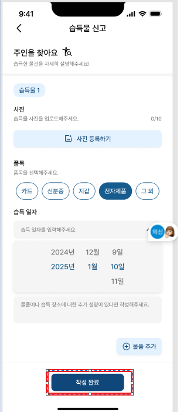
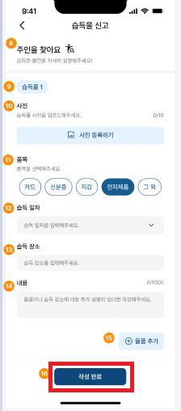

# 11-4.분실물_습득물신고_작성완료_클릭

원문 페이지 ID: 1b10221954bc832b8752812eb3aaa340

> 누락 원본 복구 스냅샷. 원본의 과거값·검토 기록을 보존하며 생성 계약으로 자동 승인하지 않습니다.

대조 기록: [87개 원본 복구 및 8개 차이 정리](../recovery-review.md)

관련 기존 보관본: [11-4.분실물_습득물신고_작성완료_클릭](35d0221954bc838c872c8173f1d6171a.md), [11-4.분실물_습득물신고_작성완료_클릭](ba70221954bc83ea9da38144dc40788d.md)

## 원문 속성

```json
{
  "platform": [
    "ANDROID",
    "IOS",
    "WEB"
  ],
  "url": "source-page-id:1b10221954bc832b8752812eb3aaa340",
  "상태": "완료",
  "이름": "11-4.분실물\\_습득물신고\\_작성완료\\_클릭"
}
```

<ul>
<li>
설명:  습득물 신고 글쓰기 페이지에서 작성완료 클릭
</li>
<li>
event\_label : “find\_user\_write\_confirm”
</li>
<li>
value : “작성완료” 
</li>
<li>
event\_category : “click”
</li>
<li>
참고사진
</li>
</ul>





WEB Mobile View



