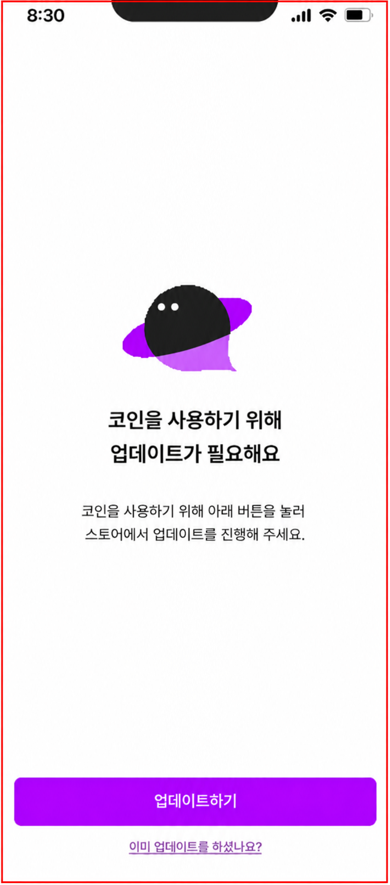

# 1. 강제 업데이트 화면 표시

원문 페이지 ID: 1b10221954bc8396bdc781ad0428b503

> 원문 스냅샷. 명세 확정·앱 배포·수집 완료를 뜻하지 않습니다.

## 원문 속성

```json
{
  "platform": [
    "ANDROID",
    "IOS"
  ],
  "url": "source-page-id:1b10221954bc8396bdc781ad0428b503",
  "상태": "로깅 필요",
  "이름": "1\\. 강제 업데이트 화면 표시"
}
```

<details>
<summary>새 로깅</summary>

- 설명: 강제 업데이트 화면이 사용자에게 실제 표시될 때 화면 표시 1회당 기록한다. 단순 재렌더에는 중복 전송하지 않는다.
- screen\_view: <code>forced_update</code>
- event\_name: <code>DA1</code>
- event\_label: <code>main__forced_update__app_update__exposure</code>
- value: v\{현재 앱 버전\} (예: v4.0.0)
- event\_category: <code>exposure</code>

<details>
<summary>검토사항</summary>

- 기존 Android onCreate 시점과 새 실제 표시 조건의 대응·중복 방지는 개발 확인이 필요하다.
- 새 계약의 event\_label·screen\_view·event\_name은 IOS·ANDROID·WEB에서 동일하다. 실제 기능이 없는 플랫폼에는 전송하지 않는다. SDK 구현·배포·실수집 검증은 별도다.
- 기존 코드·값 차이·검토 이력은 원문 (원문 ID: 4159ae650b5980098d00ede0491dca90)에 보존한다. 신·구 label을 한 동작에 병행 전송하지 않는다.
</details>
</details>

### 참고사진 (강제 업데이트 화면 표시)

<b>웹</b>

<b>참고사진 · 웹</b>

웹 (PC·모바일 웹) — 해당 화면의 실제 이미지 미확보. 앱 이미지를 웹 이미지로 대신 표시하지 않는다.

<b>모바일</b>

<b>참고사진 · 모바일</b>

모바일 — 빨간 외곽선은 강제 업데이트 화면 표시 이벤트의 전체 화면 범위다. 특정 버튼 클릭을 뜻하지 않는다. 사용자 제공 큰 디자인 이미지를 편집한 참고사진이며 실기기·SDK 검증 사진은 아니다.


