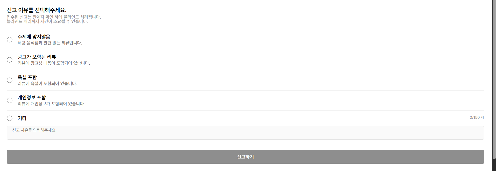
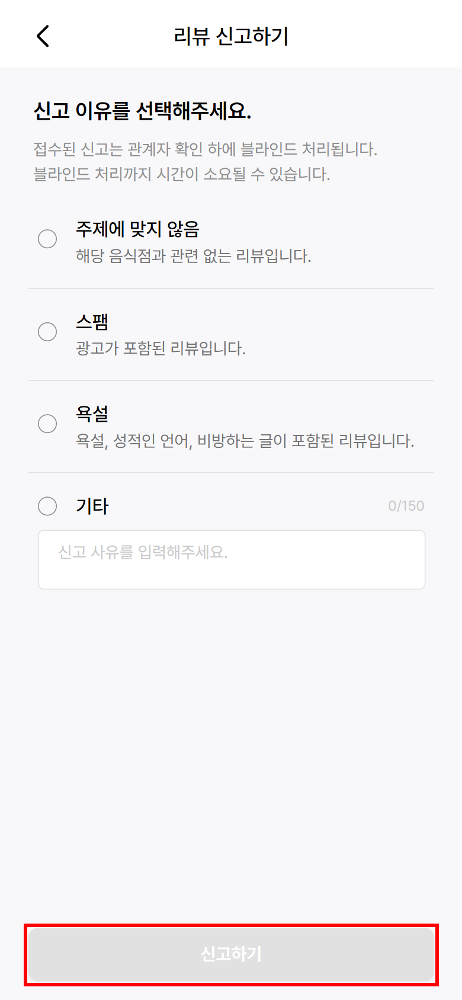
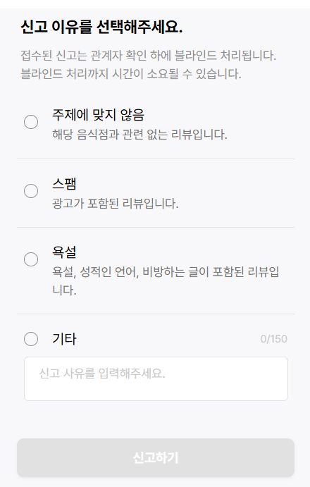

# 3-15 상점상세 리뷰 신고 완료 (클릭) 

원문 페이지 ID: 1c30221954bc821593a4012b899e49ec

> 원문 스냅샷. 명세 확정·앱 배포·수집 완료를 뜻하지 않습니다.

## 원문 속성

```json
{
  "platform": [
    "WEB",
    "ANDROID",
    "IOS"
  ],
  "url": "source-page-id:1c30221954bc821593a4012b899e49ec",
  "상태": "완료",
  "생성일": "2026-11-08T10:51:48.607Z",
  "이벤트 이름": "<p>\n3-15 상점상세 리뷰 신고 완료 (클릭) \n</p>",
  "태그": [
    "3. 상점 상세 페이지"
  ]
}
```

<details>
<summary>이전 로깅</summary>

<span color="orange">event\_params.key</span>

<ul>
<li>
event\_label : shop\_detail\_view\_review\_report\_done
</li>
<li>
value : \{상점이름\} 
</li>
<li>
event\_category : click
</li>
</ul>

---

<p>
신고하기 완료 버튼을 누르는 행위 입니다. 
</p>
</details>

<details>
<summary>새 로깅 (26.10.17)</summary>

- 설명: 리뷰 신고 화면에서 신고하기(완료) 버튼을 클릭하는 경우
- screen\_view: <code>shop_detail</code>
- event\_name: <code>DA1</code>
- event\_label: <code>shop__shop_detail__review_report__confirm__click</code>
- value: \{상점이름\} (예: 복지관 매점)
- event\_category: <code>click</code>

<details>
<summary>검토사항</summary>

- 통합 가이드: [로깅 통합 가이드](3c30221954bc8214b1c481c5bbb6fba5.md)
- 웹: 신고하기 버튼 클릭 시
- label DA2 기준 정렬 (2026-10-27): <code>shop__shop_detail__review_report__submit__click</code> → <code>shop__shop_detail__review_report__confirm__click</code>
- 사진 플랫폼 확인 완료 (이미지 비율 기준: 모바일, 780x1688): stage 캡처(shop\_review\_report\_submit.png)를 모바일 토글로 옮겼다.
</details>

### 참고사진 (리뷰 신고 완료)

<columns>
<column ratio="50">
<b>웹</b>

<details>
<summary>참고사진 · 웹</summary>

웹 — 신고하기 버튼 클릭 시 (출처: 기존 캡처)


</details>
</column>
<column ratio="50">
<b>모바일</b>

<details>
<summary>참고사진 · 모바일</summary>

모바일 — 신고하기 버튼 클릭 (출처: stage 실제 캡처, 빨간 네모 = 클릭 위치)



모바일 — 신고하기 버튼 클릭 (출처: 기존 캡처)


</details>
</column>
</columns>
</details>
