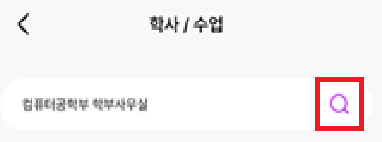
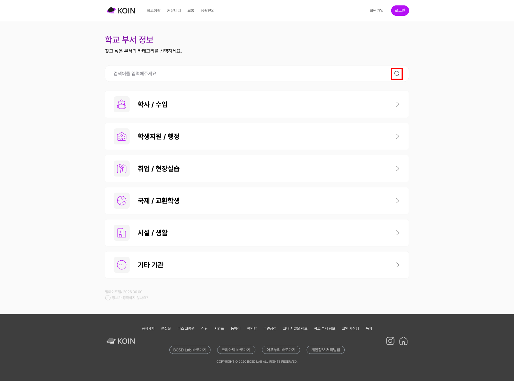
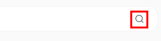
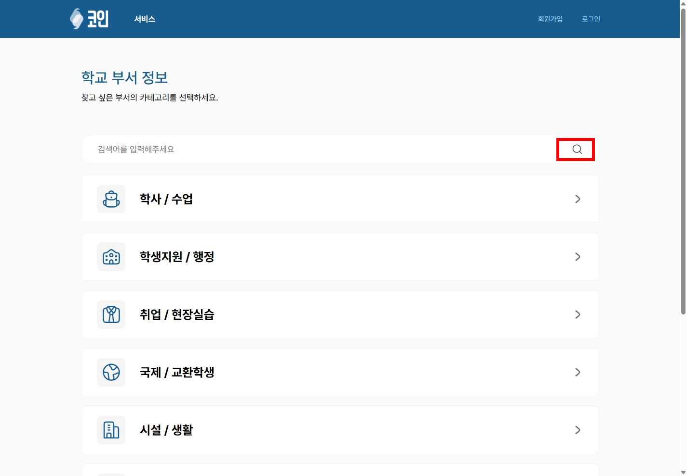
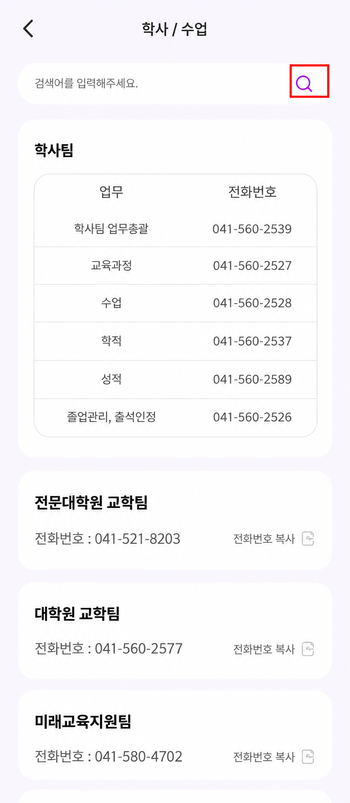

# 1-2 검색 아이콘 쿨릭

원문 페이지 ID: 1c30221954bc836b9a2d812bf49ca8a4

> 원문 스냅샷. 명세 확정·앱 배포·수집 완료를 뜻하지 않습니다.

## 원문 속성

```json
{
  "platform": [
    "ANDROID",
    "IOS",
    "WEB"
  ],
  "url": "source-page-id:1c30221954bc836b9a2d812bf49ca8a4",
  "구분": "학교 부서정보",
  "상태": "완료",
  "생성일": "2026-11-08T10:52:08.846Z",
  "이벤트 이름": "1-2 검색 아이콘 쿨릭"
}
```

<details>
<summary>이전 로깅</summary>

- event\_label : department\_search
- value : \{컴퓨터공학부 학부사무실\} or \{학생지원팀\} or \{기계공학부\} 등등 (사용자가 입력한대로 나오게 부탁드립니다.)
- event\_category : click





</details>

<details>
<summary>새 로깅 (2026-10-14) — 초안</summary>

<b>분류 화면 — WEB 확인 사례</b>

- 설명: 부서 분류 화면에서 검색 아이콘을 클릭하거나 Enter로 검색을 실행하는 순간 입력한 검색어를 전송한다.
- screen\_view: <code>department_main</code>
- event\_label: <code>department__department_main__search__click</code>

<b>목록 화면 — mobile (ANDROID, IOS) 확인 사례</b>

- 설명: 부서 목록 화면에서 검색 아이콘을 클릭하거나 Enter로 검색을 실행하는 순간 입력한 검색어를 전송한다.
- screen\_view: <code>department_list</code>
- event\_label: <code>department__department_list__search__click</code>
- event\_name: <code>DA2</code>
- value: \{컴퓨터공학부 학부사무실\} or \{학생지원팀\} or \{기계공학부\} 등등 (사용자가 입력한대로 나오게 부탁드립니다.)
- event\_category: <code>click</code>

<details>
<summary>검토사항</summary>

- WEB 참고사진 반영 (2026-11-04 사용자 요청 정정): 아래 새 WEB 캡처와 빨간 네모·확대본을 기준으로 클릭 위치를 확인한다. 리디자인 전 WEB 사진은 이력으로 보존하며 모바일 사진·명세와 이전 로깅은 유지한다.
- WEB 리디자인 반영 (2026-11-04 사용자 승인): WEB: 부서 선택 화면의 검색창에서 검색 아이콘 클릭 또는 Enter로 검색을 실행할 때 기존 department\_main/search/click 명세를 적용한다. 입력·포커스·결과 노출에 추가 전송하지 않는다. 검색어 value·click category 및 모바일 department\_list 명세는 유지한다.
- WEB 설계 근거: [Figma 참고 / 실제 화면 미확인](https://www.figma.com/design/DPlcYuiFxhyT5ULbqec59i/KOIN-Web?node-id=17699-29849). 기존 사진은 교체하지 않았으며 리디자인 화면의 위치 근거로 사용하지 않는다. SDK 구현·배포 시점·실제 수집은 미확인이다. 이 WEB 규정은 해당 화면의 과거 WEB 설명보다 우선하며 모바일·이전 로깅·기존 필드 값·DB 플랫폼 속성은 보존한다.
- 방식 A 반영 (2026-10-28 사용자 확인): 승인된 기존 event\_category <code>click</code>을 복원하고 label 마지막 구간을 일치시켰다. <code>department__department_main__search__submit</code> → <code>department__department_main__search__click</code>; <code>department__department_list__search__submit</code> → <code>department__department_list__search__click</code>. label 끝에 맞춰 category를 바꾼 과거 후속 메모는 이 결정으로 대체한다. 기존 value·event\_name·플랫폼·전송 시점은 유지하며 성공/실패 이벤트를 새로 만들지 않는다.
- label 통일 (2026-10-27): <code>department__department_main__search__search_submit</code> → <code>department__department_main__search__submit</code>, <code>department__department_list__search__search_submit</code> → <code>department__department_list__search__submit</code> (중복 detail 없이 통합안 2-2 규칙). 참고: event\_category는 click으로 남기고 변경하지 않았다(label 끝 submit과 불일치, 확인 필요). → 2026-10-27 해소
- 승인 category 복원 확인 (2026-10-28): 이전 사용자 방식 A 승인에 따라 기존 click을 유지한다. label 끝 단어만 click에 맞추며, category를 select/submit/toggle로 변경하라는 과거 후속 메모는 철회한다.
</details>

- 발생 시점 확정: 검색 아이콘 클릭 또는 Enter 검색 실행 시 입력한 검색어를 value에 저장한다. 결과가 표시되는 시점의 이벤트와 구분한다. 두 실행 방식 모두 기존 승인 category click을 유지하며, 현행 label은 <code>department__department_main__search__click</code> / <code>department__department_list__search__click</code>이다. 검색창이 확인된 플랫폼별 고정 화면 사례만 사용한다.

### 참고사진 (기능 표시)

<b>웹(데스크톱)</b>

<details>
<summary>참고사진 · 웹</summary>

WEB 리디자인 · [Figma 시안](https://www.figma.com/design/DPlcYuiFxhyT5ULbqec59i/KOIN-Web?node-id=17699-29689) · 2026-11-04. 빨간 네모는 이 명세의 클릭 위치다. 원본 캡처에 코드로 테두리만 표시했으며 실제 서비스 캡처·배포 완료를 의미하지 않는다. 검색 아이콘 위치 예시다. Enter 검색은 기존 발생 조건을 따른다.

<b>전체 화면</b>



<b>클릭 위치 확대</b>



<details>
<summary>이전 WEB 참고사진 (리디자인 전)</summary>

화면 정의의 실제 데스크톱 웹 캡처(2026-10-13). 이번 작업은 기존 캡처를 사용. 분류 화면 예시. 최신 목록 캡처에는 검색창이 보이지 않음.


</details>
</details>

<b>모바일 (ANDROID, IOS) / 캡처 출처는 아래 참조</b>

<details>
<summary>참고사진 · 모바일</summary>

화면 정의의 Android 실제 캡처(2026-10-13), 선명도 개선본. 목록 화면 검색 아이콘. 검색 결과 실제 화면은 사용자 확인 완료(2026-10-16). 기존 고정 화면명과 검색 실행 시점을 유지한다.


</details>
</details>
