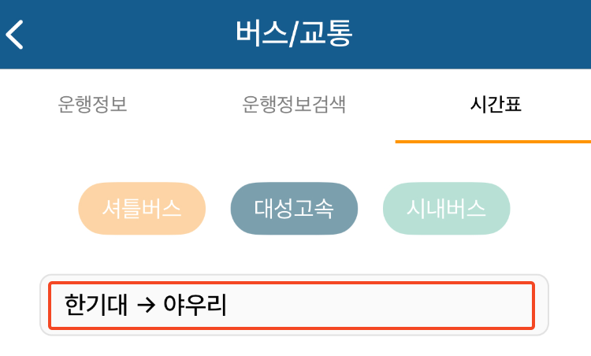

# 3-9. 버스_시간표_학교셔틀_시간&장소_클릭

원문 페이지 ID: 1c50221954bc8272bc980115492da6db

> 사용자 제공 ZIP 내보내기 보관본. 레거시·동결·검토 상태는 원문을 따르며 코드 생성 승인·앱 배포 완료를 뜻하지 않습니다.

생성일: 2026년 11월 12일 오후 2:07
태그: 3. 버스/교통 상세 페이지
platform: ANDROID, IOS, WEB
구분: 시간표 (WEB / Android / iOS)
상태: 레거시

- 과거 로깅
    - event_label : “bus_timetable_time”
    - value : “{드롭다운 목록}**”**
    - event_category : “click”
    - 참고사진
    
    
    
    ---
    
    (web만 재로깅 부탁드립니다)
    
    웹의 경우 event_label이 “bus_timetable_shuttle_route”으로 로깅되어 있어 안드, iOS와 상이합니다.
    event_label : “bus_timetable_shuttle_route” → “<u>bus_timetable_time”</u>로 변경 부탁드립니다.
    
- 새 로깅
    - 레거시: 지금 앱에 없는 화면(구 시간표의 학교셔틀 드롭다운)이라 새 로깅을 만들지 않는다.
    - 대체 로깅: 4-6. 지역별 세부 노선_클릭 (`bus__bus_timetable__shuttle_route__entry__click`)
    
    ### 참고사진 (기능 표시)
    
    **웹**
    
    **참고사진 · 웹**
    
    웹 — 해당 없음 (레거시)
    
    **모바일**
    
    **참고사진 · 모바일**
    
    모바일 — 해당 없음 (레거시)
