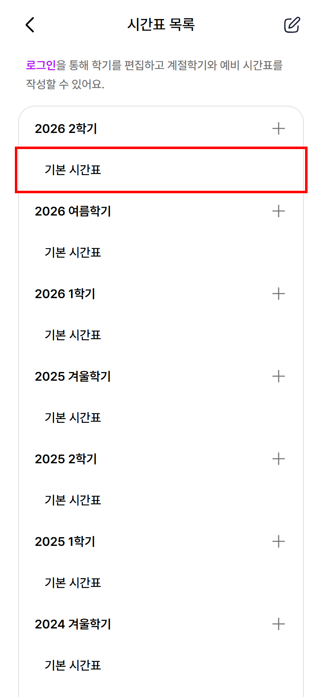

# 2-27. (앱, 반응형 웹) 시간표 목록_시간표 선택 (클릭) - 추가된 로깅

원문 페이지 ID: 1c80221954bc8238850581515bdc2982

> 원문 스냅샷. 명세 확정·앱 배포·수집 완료를 뜻하지 않습니다.

## 원문 속성

```json
{
  "platform": [
    "ANDROID",
    "IOS",
    "WEB (모바일)"
  ],
  "url": "source-page-id:1c80221954bc8238850581515bdc2982",
  "상태": "로깅 필요",
  "생성일": "2026-11-12T05:08:09.815Z",
  "이벤트 이름": "2-27. (앱, 반응형 웹) 시간표 목록\\_시간표 선택 (클릭) - 추가된 로깅",
  "태그": [
    "시간표"
  ]
}
```

<details>
<summary>과거 로깅</summary>

- 없음 (새로 추가한 로깅)
</details>

<details>
<summary>새 로깅</summary>

- 설명: 모바일 시간표 목록 화면에서 학기 아래 시간표 하나를 골라 그 시간표를 보는 시간표 화면으로 돌아가는 경우
- screen\_view: <code>timetable_list</code>
- event\_name: <code>DA1</code>
- event\_label: <code>timetable__timetable_list__timetable_list__select</code>
- value: \{연도\}\_\{학기\}\_\{시간표명\} (예: 2026\_2학기\_기본 시간표)
- event\_category: <code>select</code>

### 참고사진 (기능 표시)

<columns>
<column ratio="50">
<b>웹</b>

<b>참고사진 · 웹</b>

해당 없음 (모바일 전용)
</column>
<column ratio="50">
<b>모바일</b>

<b>참고사진 · 모바일</b>

모바일 — 시간표 목록에서 시간표 선택 (출처: stage 실제 캡처, 빨간 네모 = 클릭 위치)


</column>
</columns>
</details>
