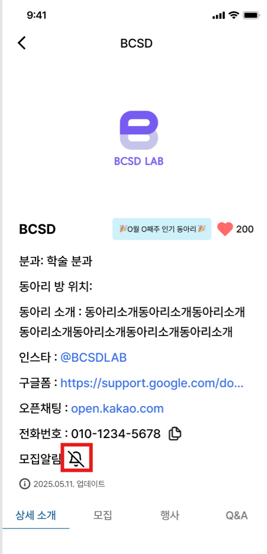

# 5.14동아리_모집알림 클릭

원문 페이지 ID: 1cc0221954bc8243865d81bc1e54b816

> 사용자 제공 ZIP 내보내기 보관본. 레거시·동결·검토 상태는 원문을 따르며 코드 생성 승인·앱 배포 완료를 뜻하지 않습니다.

platform: ANDROID, IOS
상태: 로깅 필요

- 설명: 동아리 소개 화면에서 모집알림 버튼 클릭
- event_name : “CAMPUS”
- event_label : “club_recruitment_noti”
- value : {동아리명}
- event_category : “click”
- 참고사진

