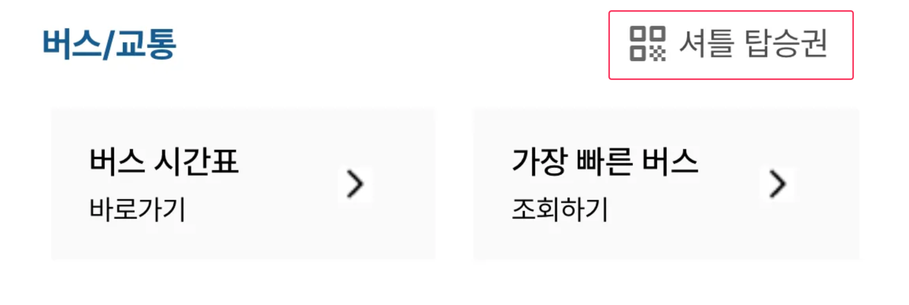
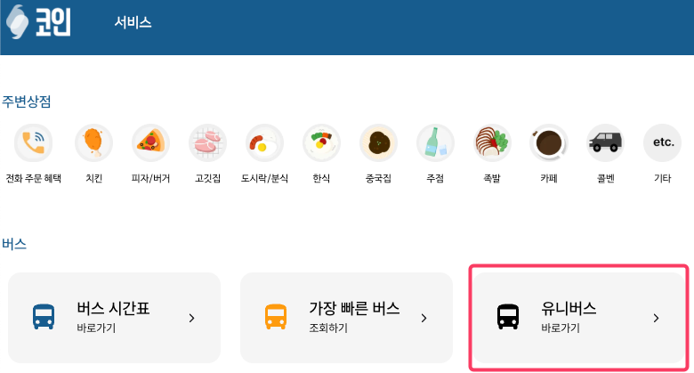
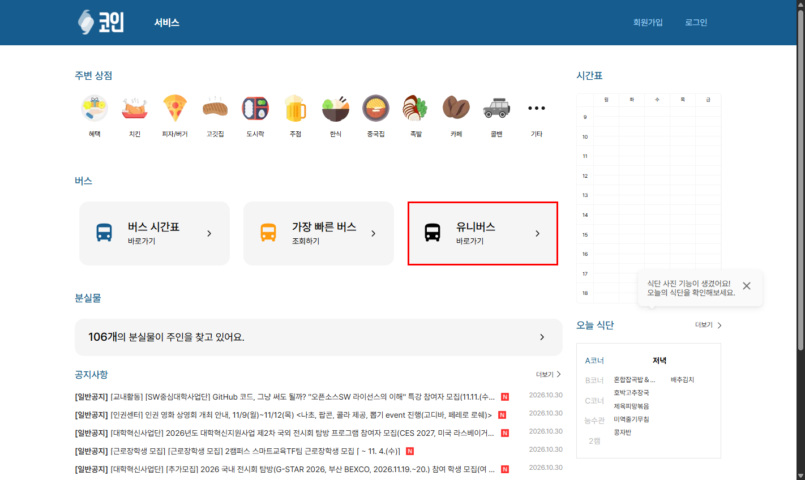
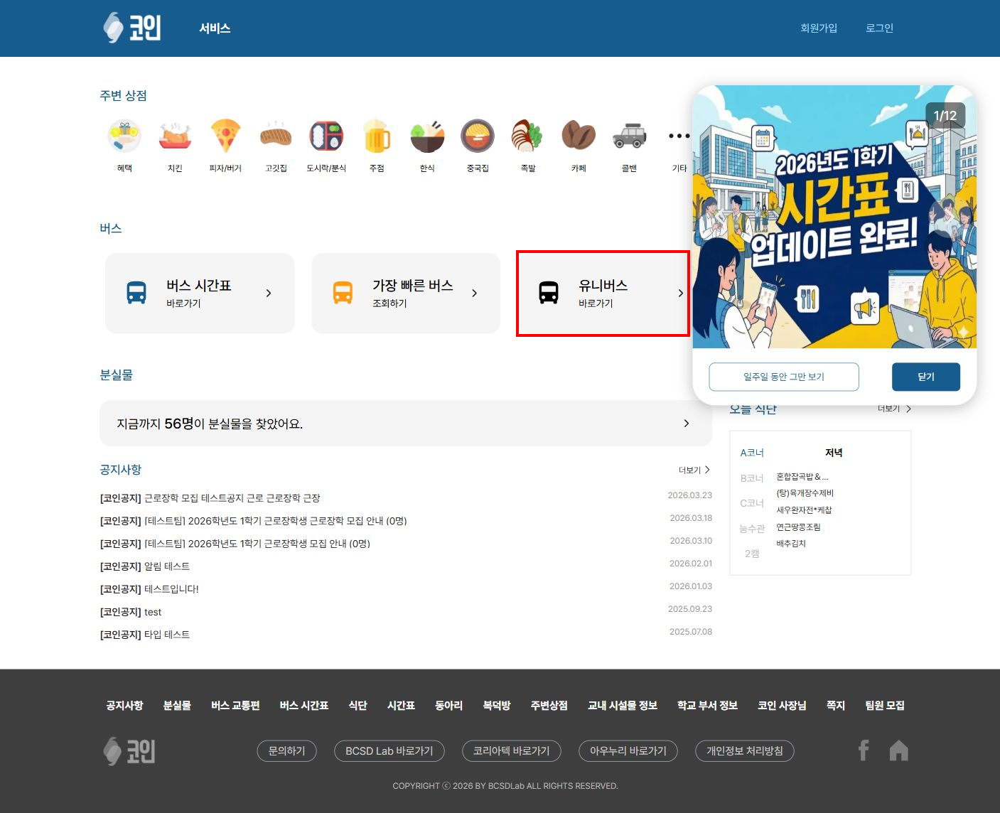
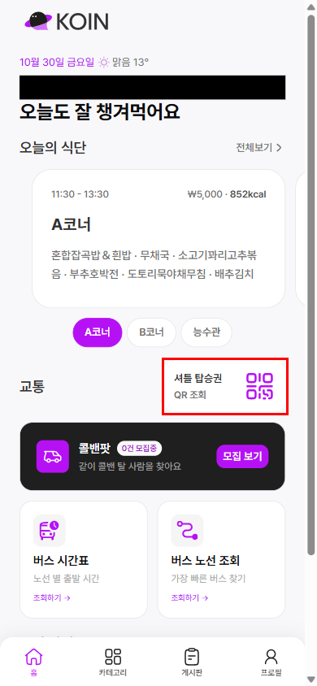
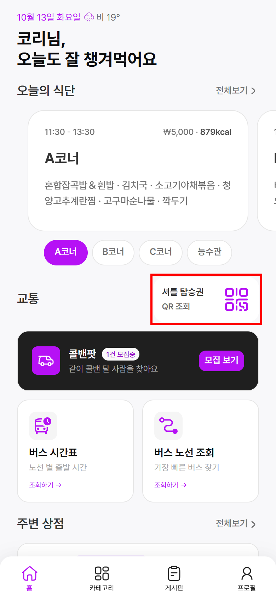

# 1-11. 셔틀 탑승권_클릭 (레거시)

원문 페이지 ID: 1e10221954bc8268a989013ec93c6966

> 원문 스냅샷. 명세 확정·앱 배포·수집 완료를 뜻하지 않습니다.

## 원문 속성

```json
{
  "platform": [
    "ANDROID",
    "IOS",
    "WEB"
  ],
  "url": "source-page-id:1e10221954bc8268a989013ec93c6966",
  "상태": "로깅 필요",
  "생성일": "2026-11-08T10:51:36.489Z",
  "이벤트 이름": "1-11. 셔틀 탑승권\\_클릭 (레거시)",
  "태그": [
    "1. 메인_버스/교통"
  ]
}
```

<callout icon="📁" color="gray_bg">
<b>레거시 보존 · 현행 새 로깅은 홈으로 이관</b>

- 2026-11-04 사용자 지시로 이 페이지는 이력만 보존한다.
- 현행 기준 명세: [1-5 서틀 탑승권 클릭](36c0221954bc836db2c2015d443eb2ea.md).
- 이관 후 event\_label: <code>main__main__bus_entry__ticket_entry__click</code>. 아래 이관 전 라벨·값·사진은 보존 기록이며 별도 신규 구현·추가 전송 대상으로 사용하지 않는다.
- 실제 SDK 전환·배포·수집 중단 여부는 미확인이다. 기존 플랫폼과 상태 속성은 유지했다.
</callout>

<details>
<summary>이전 로깅</summary>

- event\_label : “shuttle\_ticket”
- value : “셔틀 탑승권<b>”</b>
- event\_category : “click”
- 참고사진





AND, IOS, WEB(Mobile view)





WEB

</details>

<details>
<summary>이관 전 새 로깅 (26.10.17) — 레거시 보존</summary>

- 설명: 메인 화면에서 셔틀 탑승권 버튼을 클릭하는 경우
- screen\_view: <code>main</code>
- event\_name: <code>DA1</code>
- event\_label: <code>bus__main__bus_entry__ticket_entry__click</code>
- value: 셔틀 탑승권
- event\_category: <code>click</code>

<details>
<summary>검토사항</summary>

- 사진 링크 대응 확인 (2026-10-30): 운영 PC 유니버스 카드와 보라색 모바일 홈 셔틀 탑승권의 href가 모두 [https://koreatech.unibus.kr/](https://koreatech.unibus.kr/) 임을 실제 DOM에서 확인했다. 모달을 닫은 운영 WEB 사진으로 보완했다. 정적 링크 대응 확인이며 SDK 발화·네이티브 앱 동작은 미확인이다.
- 사진 재검수 (2026-10-30): 웹·보라색 모바일 웹을 실제 화면으로 교체하고 교체 전 사진을 이력으로 보존했다. UI 재생성 없이 검은색 개인정보 마스킹과 빨간 테두리만 적용했다. 기존 사진의 생성형 편집 여부는 이 작업에서 확정하지 않는다.
- 통합 가이드: [로깅 통합 가이드](3c30221954bc8214b1c481c5bbb6fba5.md)
- 웹/모바일 참고사진 추가 완료 (stage 캡처에 빨간 네모, 2026-10-28).
- label DA2 기준 정렬 (2026-10-27): <code>bus__main__shuttle_ticket__click</code> → <code>bus__main__bus_entry__ticket_entry__click</code>
- 사진 정정 (2026-10-30): 생성형 편집본과 동일했던 WEB 파일을 보유 stage 원본에 코드로 테두리만 그린 파일로 교체했다. 해상도·박스 밖 픽셀은 원본과 동일하며 이전 로깅·모바일 사진·라벨·필드는 유지한다.
</details>

### 참고사진 (기능 표시)

<columns>
<column ratio="50">
<b>웹</b>

<details>
<summary>참고사진 · 웹</summary>





WEB · 2026-10-30 운영 사이트 실제 캡처. 빨간 테두리=유니버스 진입 카드. PC 유니버스와 보라색 모바일 홈의 셔틀 탑승권 링크가 모두 [https://koreatech.unibus.kr/](https://koreatech.unibus.kr/) 인 것을 DOM href로 확인했다. 모달을 닫은 상태이며 실제 SDK 전송은 미확인이다.

</details>

<details>
<summary>교체 전 참고사진 · 웹 (이력)</summary>





WEB · 보유 stage 원본 캡처(2026-10-27)에 코드로 빨간 테두리만 표시. 메인 유니버스/셔틀 탑승권 카드의 보이는 진입 영역이며 팝업·문구·배치는 원본 그대로다. 2026-10-30 재편집; 실제 SDK 발화 검증과 별개.


</details>
</column>
<column ratio="50">
<b>모바일</b>

<details>
<summary>참고사진 · 모바일</summary>





모바일 웹 · 운영 보라색 홈 실제 캡처. 빨간 테두리=셔틀 탑승권 진입. 이름은 검은색 마스킹. Android/iOS 앱 캡처와 구분. 2026-10-30.

</details>

<details>
<summary>교체 전 참고사진 · 모바일 (이력)</summary>

모바일 — 셔틀 탑승권 (출처: stage 실제 캡처, 빨간 네모 = 클릭 위치)


</details>
</column>
</columns>
</details>


