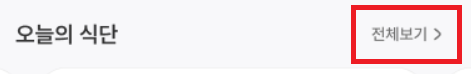
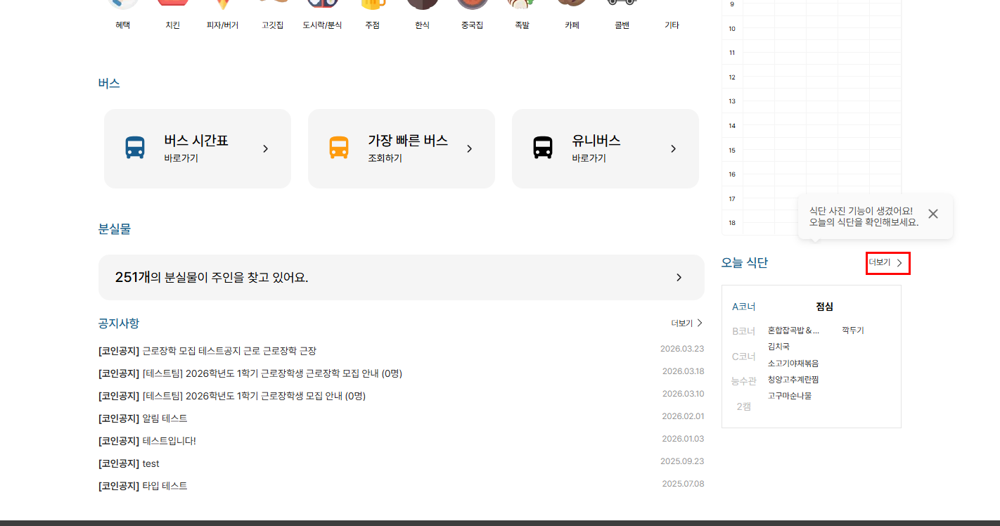
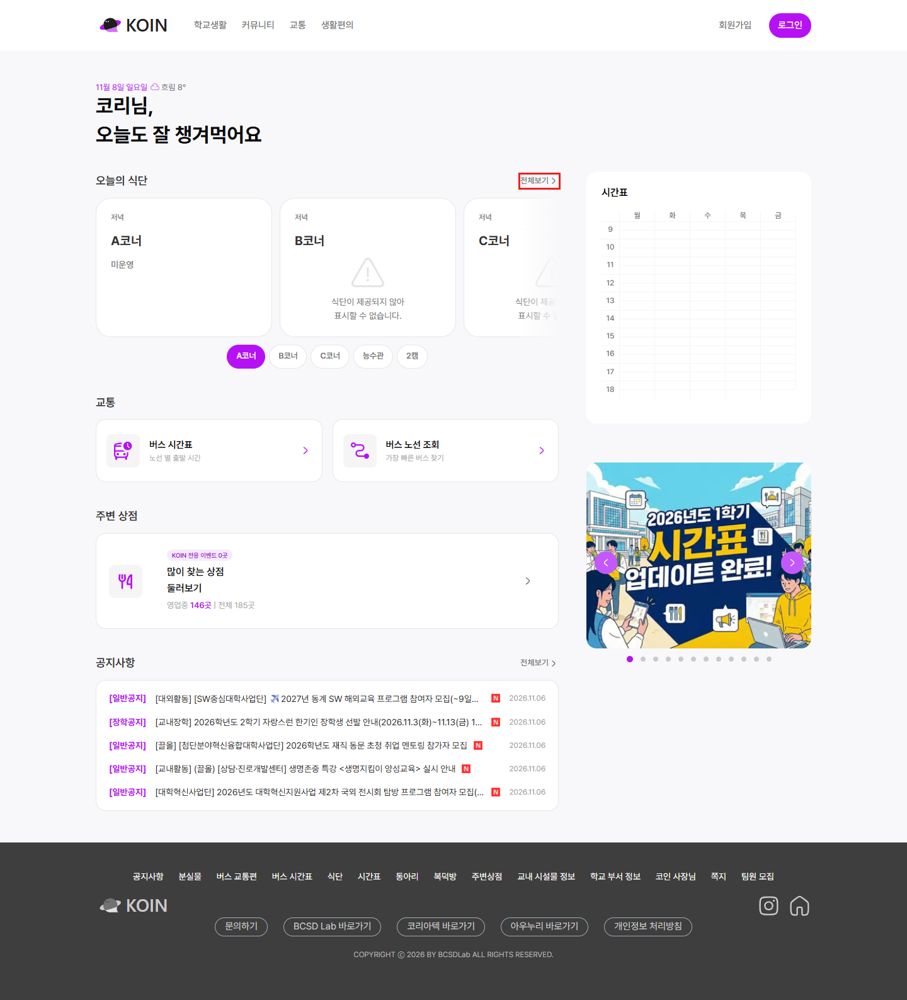
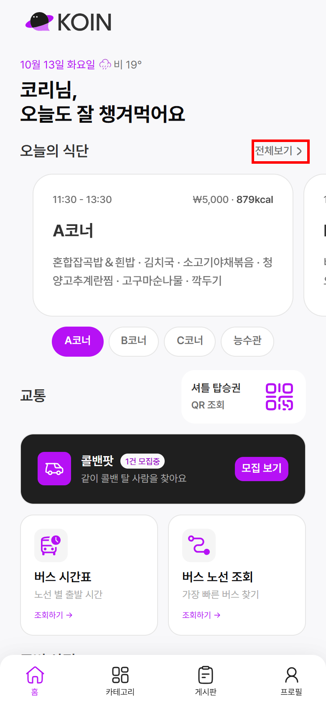
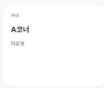
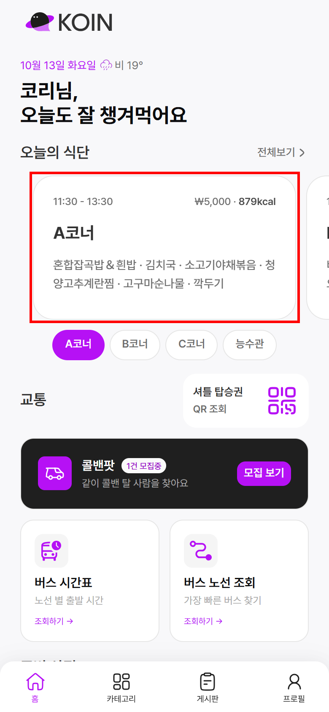

# 1-3 메인 식단 진입 클릭

원문 페이지 ID: 1f10221954bc82f6a17401f823455276

> 원문 스냅샷. 명세 확정·앱 배포·수집 완료를 뜻하지 않습니다.

## 원문 속성

```json
{
  "platform": [
    "ANDROID",
    "IOS",
    "WEB",
    "WEB (모바일)"
  ],
  "url": "source-page-id:1f10221954bc82f6a17401f823455276",
  "구분": "홈화면",
  "상태": "완료",
  "생성일": "2026-11-12T05:08:00.198Z",
  "이벤트 이름": "1-3 메인 식단 진입 클릭"
}
```

<details>
<summary>과거 로깅</summary>

- event\_label : today\_meal
- value : 전체보기
- event\_category : click





- 설명: 홈 식단 영역의 전체보기·더보기 버튼 또는 PC 웹의 식단 제목을 눌러 식단 페이지로 진입할 때 기록한다. 일반 식단 카드 본문 클릭과 코너 선택은 포함하지 않는다. iOS 식단 없음 안내 카드의 공유 콜백은 검토사항의 예외를 따른다.
- screen\_view: <code>main</code>
- event\_name: <code>DA1</code>
- event\_label: <code>main__main__more__click</code>
- value: \{아침, 점심, 저녁\}\_더보기 (예: 점심\_더보기)
- event\_category: <code>click</code>






</details>

<details>
<summary>새 로깅</summary>

- 설명: 메인 화면의 식단 제목·전체보기·더보기·일반 식단 카드 본문을 클릭해 식단 화면으로 진입할 때 기록한다. WEB·WEB (모바일)·ANDROID·IOS에 같은 계약을 적용한다. 코너 탭 선택과 단순 노출은 제외하며 한 번의 클릭에 한 번만 전송한다.
- screen\_view: <code>main</code>
- event\_name: <code>DA2</code>
- event\_label: <code>main__main__meal__click</code>
- value: \{식사시간\}\_\{클릭대상\} — 식사시간: 아침 / 점심 / 저녁, 클릭대상: 전체보기 / 카드 (예: 점심\_전체보기, 점심\_카드)
- event\_category: <code>click</code>

<b>웹 · Stage 화면</b>




<b>모바일 · 카드 본문</b>



<b>모바일 · 전체보기</b>


</details>
