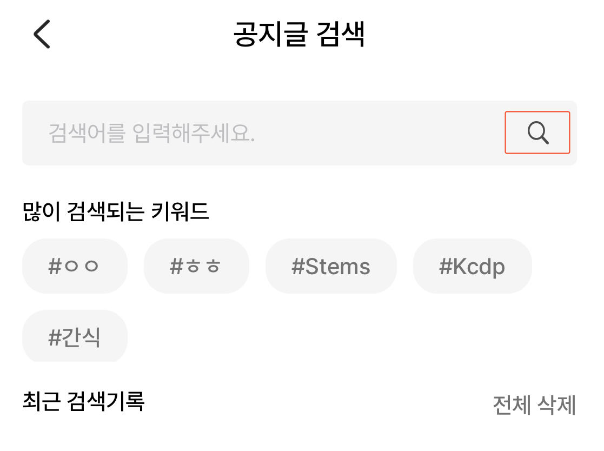

# 6-4. 공지글 검색_검색하기_클릭

원문 페이지 ID: 2020221954bc8281818e012f34fd6243

> 사용자 제공 ZIP 내보내기 보관본. 레거시·동결·검토 상태는 원문을 따르며 코드 생성 승인·앱 배포 완료를 뜻하지 않습니다.

platform: ANDROID, IOS
상태: 완료

- 설명 : 공지글 검색 페이지에서 <u>최종 검색 버튼 클릭</u>
- 주의사항 : Enter, 돋보기 버튼 모두 로깅
- event_label : “notice_search_event”
- value : “검색하기**”**
- event_category : “click”
- 참고사진
    
    
