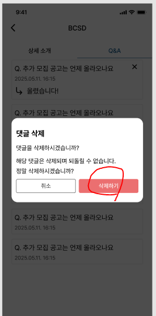
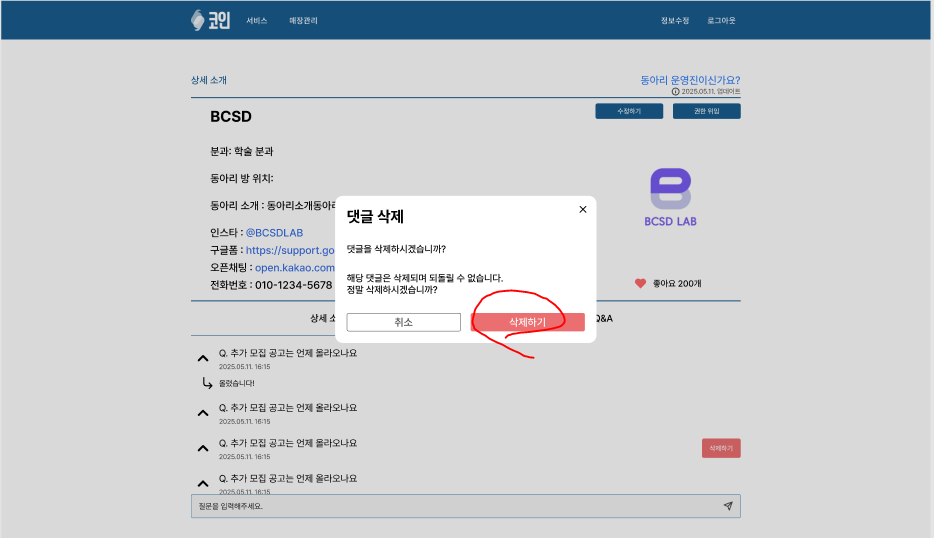
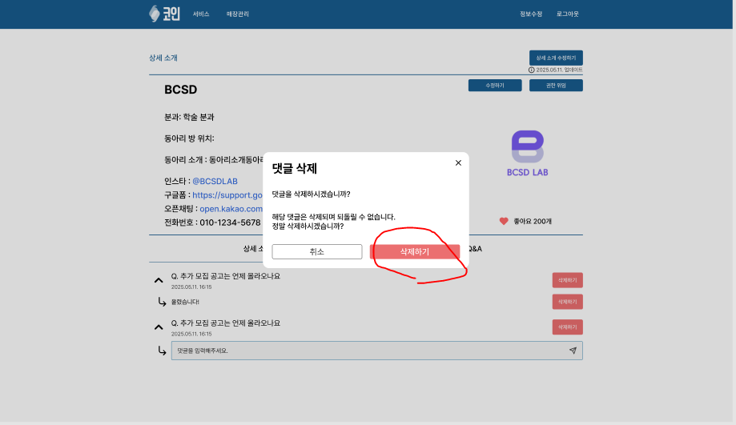

# 4-3. 동아리_댓글 삭제

원문 페이지 ID: 2140221954bc837e987101f5a4588b18

> 사용자 제공 ZIP 내보내기 보관본. 레거시·동결·검토 상태는 원문을 따르며 코드 생성 승인·앱 배포 완료를 뜻하지 않습니다.

platform: ANDROID, IOS, WEB
상태: 완료

- 설명: 댓글 삭제 팝업에서 삭제하기 클릭
- event_name : “CAMPUS”
- event_label : “club_Q&A_delete_confirm”
- value : “삭제하기”
- event_category : “click”
- 참고사진

- 웹 참고사진

- 웹 참고사진2(관리자 버전)

